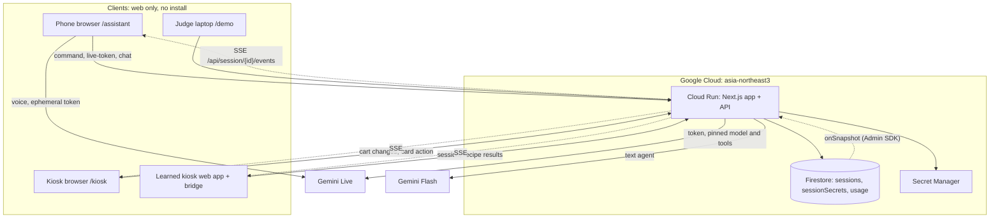
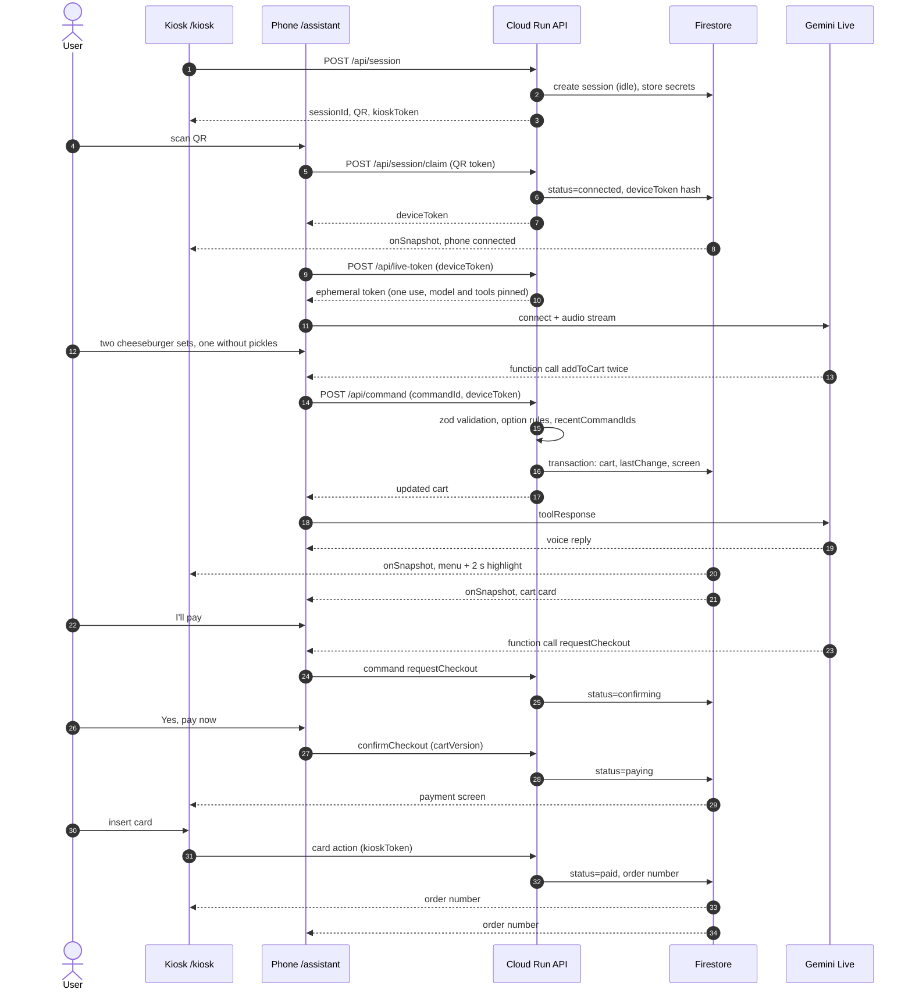
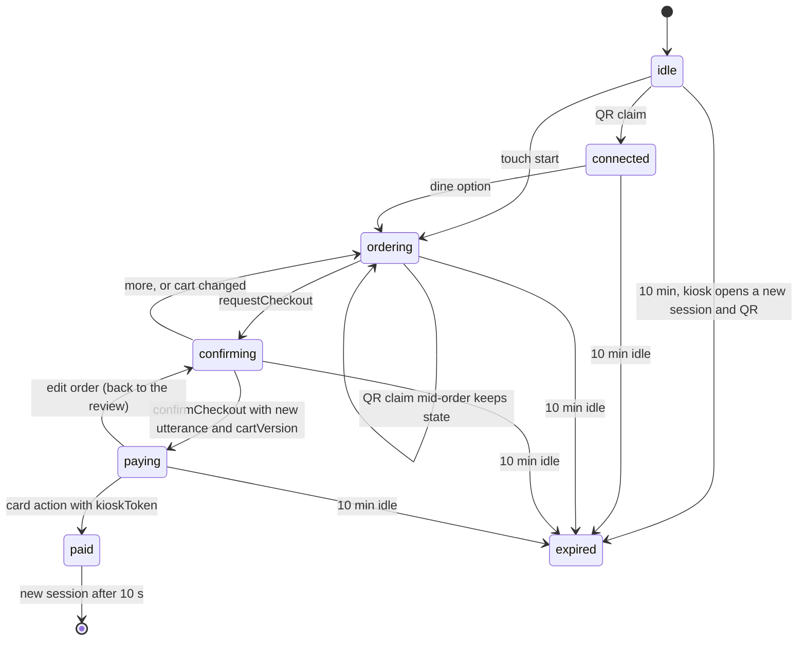

# KIBO: Kiosk Intelligence Bridge & Operator

**Don't learn the kiosk. Just talk.** Say your order to your own phone, and the self-order kiosk already on the counter fills the cart by itself. Built for the Google Cloud AI Builder Cup 2026.


- Live demo: https://kibo-407514467119.asia-northeast3.run.app/demo
- Video: coming with the submission
- Deck: coming with the submission

## Try it in one minute
1. Open [`/demo`](https://kibo-407514467119.asia-northeast3.run.app/demo) on a laptop and press **Start**.
2. Tap an example sentence, or say it (allow the microphone), or type your own.
3. Watch the kiosk on the left: the lines the AI added light up for 2 seconds.
4. Say "I'll pay", then confirm on the card ("Yes, pay now").
5. Tap the card stand-in on the kiosk side to "pay" and get an order number. No real payment happens.

**Two-device demo:** a laptop is the kiosk, your phone is the assistant.
1. Open [`/kiosk`](https://kibo-407514467119.asia-northeast3.run.app/kiosk) on a laptop, full screen. Beside the kiosk, a panel shows a QR code and a 6-digit code.
2. On the phone, scan the QR with the camera app, or open `/app` and tap **Scan a kiosk** or type the code.
3. Allow the camera and the microphone when asked; the panel says "Phone connected".
4. Tap **Start** and **Turn on the microphone**, choose eat here or take out, and say your order. Confirm on the phone, then tap 카드 and 카드 넣기 on the laptop.
5. In KakaoTalk, NAVER or another in-app browser, the microphone and camera often do not work: open the link in Safari or Chrome.

## What it does
- **QR connect, no install.** The kiosk start screen offers "order by talking (QR)" and "order by touch".
- **Voice ordering with Gemini.** Natural sentences, including complex ones ("two cheeseburger sets, one without pickles"), become real cart changes through tool calls.
- **Live mirror.** Every change shows on the kiosk with a 2-second highlight; the phone always shows the full cart and total.
- **Confirm before pay.** The AI can only open a confirm card; payment needs the user's own "yes" or tap, then a card action on the kiosk.
- **Safe fallbacks.** Undo, choice buttons for ambiguous orders, sold-out alternatives, a staff call for questions the menu data cannot answer, and text input when there is no microphone.
- **KIBO Learn.** For kiosks with no integration, Gemini explores the kiosk's web UI once and writes a skill; orders are then replayed without AI (offline experiments so far, see "Known limits").
- **Judge mode `/demo`.** Kiosk and assistant side by side on one screen.

## Who it is for
- **Older adults** who give up at kiosks under queue pressure: large text, one task per screen, plain words, undo, a staff button that is always visible.
- **Visitors who cannot read Korean:** the kiosk stays Korean, the phone speaks and shows English.
- **People with low vision:** voice replies, high contrast, screen-reader labels, system font size respected.
- **People who cannot speak easily, or a noisy store:** everything also works with text and large choice buttons.

The user only looks at and talks to their phone. The kiosk is a mirror that confirms what changed, and the place to pay.

## How it works

### Deployment

The learned-kiosk bridge (`LK`) is the planned in-app form of KIBO Learn; today KIBO Learn runs as offline experiments in `spikes/`.

### Voice order
`FS-->>K: onSnapshot` is shorthand: the server's Firestore listener pushes the new session to each screen over its SSE stream.


### Session state machine


### Why the AI cannot pay
Tool arguments come from the browser, so the server is the only place that can be trusted (ADR-005, ADR-006 in `docs/ADR.md`).
- **One door for every change.** Every state change is a `POST /api/command` with a `commandId`, an actor token and zod-validated arguments, applied in a Firestore transaction. Names, prices and options come only from menu data, never from arguments.
- **Actor tokens.** The one-use QR claim token becomes a `deviceToken` for the phone; the kiosk holds a `kioskToken`. Only SHA-256 hashes are stored, in a server-only collection. Each actor may send only its own commands.
- **Confirm rule.** `confirmCheckout` is accepted only in `confirming`, with a matching `cartVersion`, and either a tap on the confirm card or, from the AI, a new user utterance at least 1.5 s after the card appeared. If the kiosk opened or reopened the review, only a tap confirms.
- **Payment is the kiosk's.** `paid` comes only from the kiosk's card action with the `kioskToken`. The phone's token cannot send it.

More controls (rate limits, idempotency, no free text in public documents) are in `docs/SECURITY.md`.

## Google Cloud and Gemini
- **Gemini Live (`gemini-3.8-live`)** for voice. The phone connects directly with a one-use ephemeral token that the server issues only to a valid `deviceToken`; the model, instructions (with the whole menu and the current cart) and tools are pinned in the token with `liveConnectConstraints`, so a browser cannot change them.
- **Gemini Flash (`gemini-3.8-flash`)** with function calling for the text agent (`/api/chat`), the fallback when there is no microphone. Voice and text share one agent definition in `src/lib/agent`.
- **9 tools:** `setDineOption`, `addToCart`, `updateCart`, `removeFromCart`, `undoLastChange`, `offerChoices`, `callStaff`, `requestCheckout`, `confirmCheckout`. Mutating tools return the updated cart.
- **Firestore** is the single source of truth: one session document per order, every write in a transaction. The server listens with the Admin SDK `onSnapshot` and streams the public session to each screen over Server-Sent Events (SSE, one long HTTP response that pushes updates). Browsers never touch Firestore; the security rules deny every client read and write.
- **Cloud Run** in `asia-northeast3`, min 1 and max 3 instances, one Next.js app for the screens and the API.
- **Secret Manager** holds the Gemini API key.
- **KIBO Learn** runs Gemini on Vertex AI offline, during learning only (`spikes/`).

## Evidence
Measured rows from the evidence ledger in `docs/TESTING.md`. Each number comes from the file next to it.

| Claim | Value | Evidence |
|---|---|---|
| Agent evaluation (text agent, `/api/chat` path) | 68/70 cases passed (Korean, English and 7 more languages typed), `gemini-3.8-flash` on Vertex AI, 10-14, cases written by the KIBO team (not an external benchmark); per request median 5.7 s, p90 11.9 s; until the first command is applied median 3.4 s | `evals/results/2026-10-14T20-26.md` |
| Typed hero order on the deployed service | 6 typed turns to `/api/chat`, one after another, from a laptop in Seoul: median 4.8 s per turn (1.9–6.7 s), one run | `evidence/prod-latency.json` |
| Voice hero order on `/demo` (Gemini Live) | 2/2 runs passed on the current fixtures (English, Korean); end of speech → kiosk highlight median 1,833 ms; → first AI audio median 2,708 ms (target ≤ 2 s, missed). Through the Vertex AI relay: 2/2, 1,641 ms and 2,611 ms. All attempts on record, both paths and both fixture versions: 24, 17 passed, 6 failed upstream (the API key's credits ran out, I-104), 1 failed in the model (an add-and-undo loop, I-115). Synthetic TTS voice on a laptop, not a real phone | `evidence/voice-e2e.json`, `evidence/voice-e2e-relay.json` |
| Forged commands against a local production build | 37 of 37 refused with the documented status (wrong or missing token, AI confirm without a tap or new "yes", stale cart version, payment from the phone, bad arguments, replayed command); 5 of 5 legitimate controls accepted | `evidence/forged-commands.json` |
| Touch hero order on `/kiosk` | 24 taps, options picked while adding (automated Playwright run, taps only, not a human timing). Changing an option after adding needs delete and re-add on this kiosk: 41 taps (`evidence/touch-hero.json`) | `evidence/touch-hero-efficient.json` |
| Lighthouse 13.5.0 (automated, local production build, not the deployed URL; median of 3 loads) | Accessibility, Best Practices and SEO 100 on `/` (desktop and mobile), `/demo` (desktop), `/assistant` (mobile) and `/kiosk` (desktop); Performance 100, 98, 100, 88 and 99 | `evidence/lighthouse.json` |
| KIBO Learn, round 4: 2 kiosks built by separate AI agents, never seen before their run, learner frozen first | both learned (9.6, 14.2 min), items 62/62; 20 unseen orders without AI: **18 correct, 2 refused safely, 0 unsafe**; the skill's own total differed from the kiosk's in 2 of the 18 orders that reached one (I-197); learning cost $0.79 for both | `spikes/blind-kiosks/ROUND4.md`, `spikes/blind-kiosks/results/bk{9-bunsik,10-chicken}/final/grade-v2.json`, `evidence/learn-cost.json` |
| KIBO Learn, every never-seen kiosk so far (rounds 2–4, 6 kiosks, each new to that round's learner) | 60 orders: 32 correct, 15 refused safely, **3 unsafe** (round 2's take-out orders, I-195), 10 not learned (one kiosk never finished); skill total differed in 6 of the 35 orders that reached a kiosk total | `spikes/blind-kiosks/ROUND4.md`, `spikes/blind-kiosks/RESULTS.md`, `spikes/blind-kiosks/ROUND3.md` |
| KIBO Learn, 4 test kiosks, learner before → after its improvements | finished 2 → 4 of 4; items 57 → 134 of 134; 40 unseen orders correct 5 → 31, **unsafe 5 → 5**; in the final, the skill's own total differed from the kiosk's in 3 of the 31 orders that reached one (I-197). The learner was improved from these kiosks' baseline failures (dev set only), so the final is not a clean blind result | `spikes/blind-kiosks/RESULTS.md`, `spikes/blind-kiosks/results/bk*/{baseline,final}/grade-v2.json` |
| KIBO Learn on our pizza kiosk (the learner's development kiosk, not blind) | newest run: learned in 5.2 min, 35 turns; 4/4 unseen orders replayed without AI (1.6–2.2 s each, offline runner), plus 1 planted rule break caught | `spikes/blind-kiosks/results/dev/gemini-doughhouse-round3/` |
| Bridge replay inside the app (`/learned/doughhouse`) | 4 commands replayed and verified, 71–525 ms each; a cart edited by hand on the kiosk was caught (one automated run, 10-13) | `evidence/bridge-replay.json` |

All blind kiosks are synthetic web kiosks, one run each; every learning run used the finish gate (≥ 3 passing self-tests and a coverage audit). The groups above are never added together. OpenAI runs in `spikes/` were development aids only and are not quoted (`spikes/README.md`). Every published number and where it appears: `docs/plan/NUMBERS.md`.

### Known limits
- **KIBO Learn covers web and webview kiosks only**, and runs as offline experiments; in-app replay on a learned kiosk is not built yet. Native kiosk apps are roadmap.
- **Learned kiosks will support fewer edits:** no line edits (remove + add instead), undo only of the last add; quantity options and conditional option groups are still weak (`docs/KIBO_LEARN.md`).
- **Screens in Korean and English.** The AI also answers in Japanese, Chinese (Simplified), Spanish, Vietnamese, French, Thai and Indonesian, tested by typing only (`evidence/live-languages.json`); speaking them is not tested. The kiosk UI starts in Korean.
- **Virtual payment.** No real payment, POS, coupons or memberships.
- **Numbers from automated runs are labelled as such.** Voice latency was measured with a synthetic voice on a laptop; real-phone and touch-vs-voice measurements are still planned.

## Run locally
Needs Node 24.
```bash
npm ci
echo "GEMINI_API_KEY=<your key>" > .env   # git-ignored; never commit it; used for voice and the text agent
gcloud auth application-default login      # the text agent's Vertex AI fallback (project kibo-2026)
npm run dev                                # http://localhost:3000, in-memory store by default
```
Without a key voice answers with an error and the text agent falls back to Vertex AI. `GEMINI_TEXT_BACKEND=api` or `vertex` in `.env` pins the text agent to one backend.

Tests:
```bash
npm test                # unit tests (Vitest)
npm run test:e2e        # Playwright E2E, in-memory store, no model calls
npm run test:e2e:live   # @live tests against real Gemini (needs GEMINI_API_KEY)
npm run qa:ui           # UI checks: axe, sizes, reflow, screenshots
npm run eval:agent      # agent evaluation against real Gemini on Vertex AI (gcloud ADC)
```

Deploy (needs gcloud and access to the project; the API key comes from Secret Manager):
```bash
sh scripts/deploy.sh
```

## Repository map
| Folder | What is in it |
|---|---|
| `src/` | Next.js app: screens (`/kiosk`, `/assistant`, `/demo`), API routes, agent, commands, store |
| `data/` | Menu data for the MALO BURGER kiosk (`data/kiosks/malo.json`) |
| `public/` | Static files: logo, menu photos, landing captures, the microphone audio worklet |
| `e2e/` | Playwright E2E tests, UI QA specs (`e2e/qa/`) and voice fixtures |
| `evals/` | Agent evaluation cases and results |
| `evidence/` | Saved measurements cited above |
| `scripts/` | Deploy, agent evaluation, landing captures, voice fixtures, agent-session hooks |
| `spikes/` | KIBO Learn development experiments (see `spikes/README.md`) |
| `design/` | Brand logo, generated menu photos, the UI prototype |
| `docs/` | Product, UX, architecture, decisions, security, testing, issue log |
| `phases/` | Step-by-step build plan and QA reports |

## Credits
- **Ideas, reimplemented, no code copied:** browser-harness (browser-use): save what an agent learns as reusable skills; jev-browser: turn clickable elements into a candidate list; dev-browser and Aside: read the accessibility tree, act, verify.
- **Fonts:** IBM Plex Sans KR and Space Grotesk, SIL Open Font License.
- **Menu photos** were generated offline with image generation tools (Codex image generation; earlier ones with Gemini image generation). They are design assets, not product AI.
- **Brands:** MALO BURGER, Doughhouse and Gureum Darak Coffee are fictional. No real brands, logos, menu photos or store screens.
- Harness tooling used during development is local and not part of the submission.

Team malo: Sungmin Cho, Ye Seul Ahn.

## License
All rights reserved, for now. The team will choose a license before the repository goes public.
