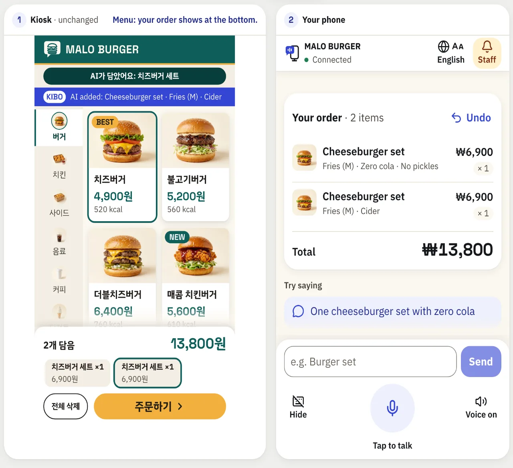
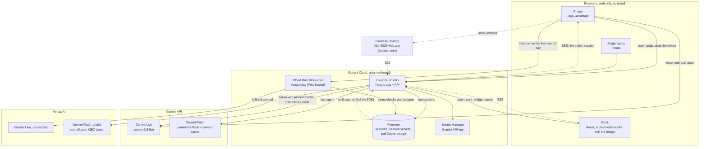
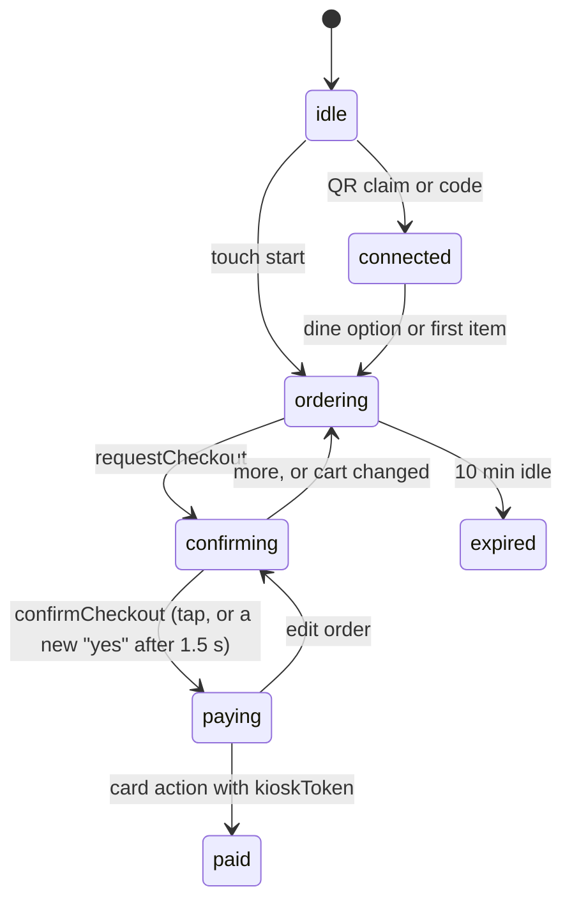

# KIBO: Kiosk Intelligence Bridge & Operator

**Don't learn the kiosk. Just talk.** Say your order to your own phone, and the self-order kiosk already on the counter fills its own cart. Gemini can fill the cart but cannot pay: payment needs your own yes or tap, then your card at the kiosk. Built for the Google Cloud AI Builder Cup 2026 (Sustainability & Social Impact).

KIBO is for older adults, people with low vision and travellers who cannot read the kiosk's language, and these groups are large worldwide: by 2030, 1 in 6 people in the world will be 60 or over ([WHO, Ageing and health, 2025](https://www.who.int/news-room/fact-sheets/detail/ageing-and-health)); at least 2.2 billion people have a near or distance vision impairment ([WHO, Blindness and vision impairment, 2026](https://www.who.int/news-room/fact-sheets/detail/blindness-and-visual-impairment)); an estimated 1.52 billion international tourist arrivals were recorded in 2025 ([UN Tourism](https://www.untourism.int/un-tourism-world-tourism-barometer-data)). None of these figures is about kiosks. Korea is one example of the kiosk problem: 17.9% of people aged 65+ say they can order or check in at a kiosk (self-reported; [KIHASA, 2024](https://www.kihasa.re.kr/api/kihasa/file/download?seq=28260), p. 32). Sources: [`docs/plan/SOURCES.md`](docs/plan/SOURCES.md) S44–S46, S16.

- **Try it:** open https://kibo-407514467119.asia-northeast3.run.app/demo on a laptop, press **Start**, and scan the kiosk's QR with your phone
- **On a phone:** open **kibo-2026.web.app** and type the 6-digit code a KIBO kiosk shows
- Video and deck: linked from the submission



The picture shows "Try it on this screen". With **Start**, the laptop shows the kiosk alone and you order on your own phone.

## Try it in 60 seconds

**With your own phone (`/demo`, the default):**
1. On a laptop, open [`/demo`](https://kibo-407514467119.asia-northeast3.run.app/demo), pick a place (burger shop, airport rail, pizza shop, or bunsik shop: a Korean snack bar KIBO learned blind) and press **Start**. The laptop becomes the kiosk: it shows the kiosk alone, with its QR and 6-digit code.
2. Scan the QR with your phone's camera (or open **kibo-2026.web.app** and type the code), and allow the microphone.
3. Talk. On the burger shop, for example: "Two cheeseburger sets for here, with large fries: one zero cola, no pickles, the other a cider." Then "That's all, I'll pay." The AI opens the order review on both screens, and confirms it on your next "yes" ("Yes, pay now.") or your tap on **Yes, pay now**, never by itself.
4. Pay on the kiosk: tap 카드 (Card), then 카드 넣기 (Insert card). The caption above the kiosk says each step in English. No real payment happens.
5. In KakaoTalk, NAVER or another in-app browser the microphone often fails: open the link in Safari or Chrome.

In one recorded take on production (10-16, `/kiosk` and the phone web app, a synthetic voice), those three sentences and the kiosk's two card taps placed order 259 (₩14,800), with no phone tap after setup ([`evidence/voice-only-hero.json`](evidence/voice-only-hero.json)).

**No phone at hand: "Try it on this screen"** on `/demo` opens the same place with a phone drawn beside the kiosk. Tap an example sentence, say it or type your own. What the AI changed lights up on the kiosk, with an English subtitle under the Korean screen, and "What the AI did" lists every Gemini tool call and the server's answer. Tap **Yes, pay now** yourself, then the card stand-in under the kiosk.

The kiosk on its own is at [`/kiosk`](https://kibo-407514467119.asia-northeast3.run.app/kiosk); `/kiosk?k=airport_rail` is the ticket machine, whose start screen also offers 日本語.

## What Gemini does, and where

| Job | Model and service | Code |
|---|---|---|
| Voice ordering with function calling | `gemini-3.8-live`. **Direct:** the phone talks to the Gemini API with a one-use ephemeral token whose model, instructions and tools are pinned (`liveConnectConstraints`). **Relay:** when the API key cannot pay, the phone's audio goes through `kibo-voice` (Cloud Run) to **Vertex AI Live in `us-central1`** | [`src/lib/agent/live.ts`](src/lib/agent/live.ts), [`src/lib/agent/liveBackend.ts`](src/lib/agent/liveBackend.ts), [`voice-relay/relay.ts`](voice-relay/relay.ts) |
| Text agent (typing, `/demo`, the fallback when there is no microphone) | `gemini-3.8-flash`, thinking `low`, on the Gemini API with an **explicit context cache** for the rules and menu; one retry per call on **Vertex AI (`global`)** on 402, 429 or 5xx | [`src/lib/agent/chat.ts`](src/lib/agent/chat.ts), [`src/lib/agent/model.ts`](src/lib/agent/model.ts), [`src/lib/agent/cache.ts`](src/lib/agent/cache.ts) |
| One agent definition for both | 10 tools (`setDineOption`, `addToCart`, `updateCart`, `removeFromCart`, `undoLastChange`, `offerChoices`, `showMenu`, `callStaff`, `requestCheckout`, `confirmCheckout`) and instructions built from the kiosk's menu data | [`src/lib/agent/tools.ts`](src/lib/agent/tools.ts), [`src/lib/agent/instructions.ts`](src/lib/agent/instructions.ts) |
| KIBO Learn: learn a kiosk that has no integration | `gemini-3.8-flash` on **Vertex AI (`global`)**, offline, driving the kiosk's web page with Playwright; orders are then replayed **without AI** | [`spikes/kibo-learn/learner.mjs`](spikes/kibo-learn/learner.mjs), [`src/lib/bridge/`](src/lib/bridge/) |

**Languages.** People talk or type to the AI in 9 languages: Korean, English, Japanese, Chinese (Simplified), Spanish, Vietnamese, French, Thai and Indonesian (a typed turn answered in each, on both voice paths, [`evidence/live-languages.json`](evidence/live-languages.json)). Spoken input is tested in English and Korean ([`evidence/voice-e2e.json`](evidence/voice-e2e.json)) and Japanese: 3 recorded runs on production, cart right 3/3, reply in Japanese 2/3 (I-377 in [`docs/ISSUE.md`](docs/ISSUE.md); [`docs/plan/NUMBERS.md`](docs/plan/NUMBERS.md) "Languages"). The phone's screens are Korean or English. The kiosk screens are Korean and English, and the airport rail ticket machine also offers 日本語: a kiosk screen language with prices in won ("10,500ウォン"), while the AI keeps working with the Korean and English names ([`data/kiosks/airport_rail.json`](data/kiosks/airport_rail.json), [`e2e/kiosk-rail-ja.spec.ts`](e2e/kiosk-rail-ja.spec.ts)).

## Google Cloud services

| Service | What it does here |
|---|---|
| **Cloud Run** `kibo` (`asia-northeast3`) | The Next.js app: kiosk, phone and demo screens, and every API route. Min 1, max 3 instances ([`scripts/deploy.sh`](scripts/deploy.sh)) |
| **Cloud Run** `kibo-voice` (`asia-northeast3`) | The voice relay: a WebSocket that runs the same token checks and budgets, then passes Live messages to Vertex AI Live in `us-central1` ([`voice-relay/`](voice-relay/), [`scripts/deploy-voice.sh`](scripts/deploy-voice.sh)) |
| **Firestore** (`asia-northeast3`) | One session document per order, every write in a transaction; server-only secrets, pairing codes and usage counters; TTL deletes expired sessions. Browsers never touch it: the rules deny every client read and write ([`firestore.rules`](firestore.rules), [`src/lib/store/firestore.ts`](src/lib/store/firestore.ts)) |
| **Firebase Hosting** | `kibo-2026.web.app`, a short address people type on a phone; it only redirects to the Cloud Run app ([`firebase.json`](firebase.json)) |
| **Gemini API** and **Vertex AI** | The models above |
| **Secret Manager** | The Gemini API key, read by Cloud Run at start; never in the repo or the browser |
| **Cloud Build**, **Artifact Registry** | Build the two services' images on deploy |
| **Cloud Monitoring** | Uptime check target: `/api/health?deep=1` checks the store, both model ids, a 1-token generation through the text backend and one on the API key, an ephemeral token and the relay ([`src/app/api/health/route.ts`](src/app/api/health/route.ts); setup in [`docs/plan/OPERATIONS.md`](docs/plan/OPERATIONS.md)) |

## Architecture



Every state change is one `POST /api/command`; screens only read the session through a Server-Sent Events stream (one long HTTP response that pushes each change). More diagrams (voice sequence, learned kiosk, state machine) are in [`docs/ARCHITECTURE.md`](docs/ARCHITECTURE.md).

## What the server enforces

Tool arguments come from the browser, so the server is the only place that can be trusted.
- **One door for every change.** `POST /api/command` with a `commandId`, an actor token and zod-validated arguments, applied in a Firestore transaction. Names, prices and options come only from menu data, never from arguments.
- **Actor tokens.** The one-use QR claim (or the 6-digit code) gives the phone a `deviceToken`; the kiosk holds a `kioskToken`. Only SHA-256 hashes are stored. Each actor may send only its own commands.
- **The AI cannot pay.** `confirmCheckout` is accepted only in `confirming`, with a matching `cartVersion`, and either a tap on the review or, from the AI, a new user utterance at least 1.5 s after the review opened. If the kiosk opened or reopened the review, only a tap confirms. `paid` comes only from the kiosk's card action.
- **Tested by attack.** 37 of 37 forged commands (wrong or missing token, an AI confirm without a tap or new "yes", a stale cart version, payment from the phone, bad arguments, a replayed command) were refused with the documented status, and 5 of 5 legitimate controls accepted ([`evidence/forged-commands.json`](evidence/forged-commands.json), [`scripts/attacks.ts`](scripts/attacks.ts)).



### Where to check each claim

| Claim | Where it lives |
|---|---|
| Confirm rule and payment states | `isConfirmed` and the `confirmCheckout` / `cardAction` cases in [`src/lib/commands/machine.ts`](src/lib/commands/machine.ts#L119); tests in [`machine.test.ts`](src/lib/commands/machine.test.ts) |
| Who may send what | `ACTOR_COMMANDS`, `ACTOR_SOURCES` in [`src/lib/commands/actors.ts`](src/lib/commands/actors.ts) |
| The command endpoint and its order of checks | [`src/app/api/command/route.ts`](src/app/api/command/route.ts), `runCommand` in [`src/lib/session/service.ts`](src/lib/session/service.ts#L240), schemas in [`src/lib/commands/schemas.ts`](src/lib/commands/schemas.ts) |
| Prices only from menu data | [`src/lib/commands/cart.ts`](src/lib/commands/cart.ts), menus in [`data/kiosks/`](data/kiosks/) |
| Firestore transactions and the SSE stream | [`src/lib/store/firestore.ts`](src/lib/store/firestore.ts#L73), [`src/app/api/session/[id]/events/route.ts`](src/app/api/session/%5Bid%5D/events/route.ts) |
| Gemini tool declarations | `toolDeclarations` in [`src/lib/agent/tools.ts`](src/lib/agent/tools.ts#L19) |
| Pinned Live token | `geminiTokenIssuer` in [`src/lib/agent/live.ts`](src/lib/agent/live.ts#L92) |
| Voice path choice and relay | `startLiveVoice` in [`src/lib/agent/liveBackend.ts`](src/lib/agent/liveBackend.ts#L126); only `realtimeInput`, `clientContent` and `toolResponse` pass the relay ([`voice-relay/relay.ts`](voice-relay/relay.ts#L54)) |
| Text fallback to Vertex AI and the prompt cache | [`src/lib/agent/model.ts`](src/lib/agent/model.ts), [`src/lib/agent/cache.ts`](src/lib/agent/cache.ts) |
| Rate limits and daily budgets | [`src/lib/limits/ip.ts`](src/lib/limits/ip.ts), [`src/lib/agent/live.ts`](src/lib/agent/live.ts#L136) |
| KIBO Learn finish gate (≥ 3 different passing self-test orders of the same skill, no failed one, every option group used, coverage audit, lint) | [`spikes/kibo-learn/learner.mjs`](spikes/kibo-learn/learner.mjs#L209), [`spikes/kibo-learn/audit.mjs`](spikes/kibo-learn/audit.mjs) |
| Replay on a learned kiosk, checked against the kiosk's own total | `createBridge` in [`src/lib/bridge/bridge.ts`](src/lib/bridge/bridge.ts#L160), [`src/lib/bridge/verify.ts`](src/lib/bridge/verify.ts), `bridgeReport` in [`machine.ts`](src/lib/commands/machine.ts) |
| Every number below | [`docs/plan/NUMBERS.md`](docs/plan/NUMBERS.md), then the evidence file named next to it |

## KIBO Learn

For kiosks with no integration, Gemini explores the kiosk's web screen once (Playwright, accessibility tree and the tappable labels), writes a **skill** (catalog plus click recipes), and may finish only after the skill passes its own AI-free self-tests and a coverage audit. Every order after that is a deterministic replay with no AI; the in-page bridge checks the kiosk's own total, and on a mismatch nothing is added and staff is called.
- **See it:** [`/learn`](https://kibo-407514467119.asia-northeast3.run.app/learn) replays recorded learning runs turn by turn; on [`/demo`](https://kibo-407514467119.asia-northeast3.run.app/demo), "Pizza shop" (Doughhouse, our development kiosk) and "Bunsik shop" (보리별 분식, a Korean snack bar built by a separate AI agent and learned blind in round 4) order on a learned kiosk and mark every tap KIBO replays.
- **Getting onto a real kiosk:** kiosks that share menu data use a direct adapter (`data/kiosks/*.json`). On a web kiosk the bridge is one script in the page, added by the vendor or store (script tag, kiosk-browser extension or WebView injection). Native kiosk apps are roadmap. There are no vendor or store partnerships yet.
- Details: [`docs/KIBO_LEARN.md`](docs/KIBO_LEARN.md), [`spikes/blind-kiosks/`](spikes/blind-kiosks/).

### Setting up a real kiosk

What it takes for a web kiosk that has no integration. Every step below has run only on synthetic kiosks; no vendor or store has installed KIBO.
1. **Learn once, offline.** Run the learner ([`spikes/kibo-learn/learner.mjs`](spikes/kibo-learn/learner.mjs), `KIOSK_URL` = the kiosk's web page) on a computer with Playwright and Gemini on Vertex AI. It never taps payment controls and may finish only after the finish gate (≥ 3 passing self-test orders and the coverage audit). A Gemini run took 5.2 minutes on Doughhouse (newest run) and 9.6 minutes on a bunsik shop kiosk (a Korean snack bar) it had never seen. Self-tests put items in the kiosk's cart, and the learner may tap the order button to read the total on the kiosk's order review, which on some kiosks sends the order (I-303), so learn on a test copy of the page or while the store is closed.
2. **A person reviews the skill.** Items, prices and options are checked by a person before use; `npm run skill:import -- <skill.json> <kioskId>` converts the skill to the product format and adds the kiosk's order button to the forbidden labels.
3. **Install the bridge.** One script in the kiosk's page, added by the vendor or store: a script tag, a kiosk-browser extension or WebView injection. In this demo the kiosk page runs inside KIBO's own page (`/learned/<kiosk>`).
4. **Network.** The kiosk needs outbound HTTPS to the KIBO server: the bridge reads the session stream and reports every replay with the kiosk token ([`docs/ARCHITECTURE.md`](docs/ARCHITECTURE.md) sequence 3). The server sends no cross-origin (CORS) headers today, because the demo's kiosk page is served from KIBO's own origin; a kiosk page on its own domain needs its origin allowed first (not built). The customer's phone needs internet too. Orders replay without AI.
5. **When the menu changes.** A changed price makes the kiosk's own total differ, so the order stops and staff is called; a changed label needs a new learning run. There is no automatic re-learning.

**Native kiosk apps: roadmap, not built.** The plan is to read and tap through the operating system's accessibility APIs (for example Windows UI Automation or Android AccessibilityService) instead of a web page ([`docs/KIBO_LEARN.md`](docs/KIBO_LEARN.md) "Known gaps").

## Results

Every value comes from [`docs/plan/NUMBERS.md`](docs/plan/NUMBERS.md) and the evidence file next to it.

| Claim | Value | Evidence |
|---|---|---|
| Text agent evaluation | 88 of 88 cases (Korean, English and 7 more languages typed), `gemini-3.8-flash` with the production backend setting (Gemini API key first; it answered every call), one full run on the final code, 10-18; per request median 4.5 s, p90 7.6 s; until the first command median 2.4 s. Cases written by the KIBO team, not an external benchmark | [`evals/results/2026-10-18T15-02.md`](evals/results/2026-10-18T15-02.md) |
| Typed order on the deployed service | a full order sentence (two sets in one message) median 4.5 s (4 turns, 4.4–4.9 s); short follow-ups (dine option, "make both fries large", "I'll pay") median 2.3 s (8 turns, 2.0–2.6 s); all 12 turns median 2.3 s, p90 4.5 s. One run from a laptop in Seoul, revision `kibo-00019-rmt`, 10-15 | [`evidence/prod-latency.json`](evidence/prod-latency.json) |
| Voice order on `/demo` | 4/4 runs passed direct (English and Korean, two runs each): end of speech → kiosk highlight median 1,669 ms, → first AI audio 2,382 ms (target ≤ 2 s, missed). Through the Vertex AI relay (run locally, not on Cloud Run) 4/4: 1,715 ms and 2,841 ms. All attempts on record: 40, 28 passed, 6 failed upstream (the API key's credits ran out), 2 failed in the model, 4 failed in two later runs (one cart not reached, three Korean orders filled the cart without a Korean reply shown) (`docs/plan/NUMBERS.md`). Synthetic voice on a laptop, not a real phone | [`evidence/voice-e2e.json`](evidence/voice-e2e.json), [`evidence/voice-e2e-relay.json`](evidence/voice-e2e-relay.json) |
| Cost per hero order | text $0.0080, voice $0.0885 (median of 3; Gemini API list prices) | [`evidence/cost-per-order.json`](evidence/cost-per-order.json) |
| Forged commands | 37 of 37 refused; 5 of 5 legitimate controls accepted | [`evidence/forged-commands.json`](evidence/forged-commands.json) |
| Touch hero order on `/kiosk` | 24 taps (automated run, taps only), counted as the kiosk's demo counter counts: from 매장에서 먹기 (Eat here) to 카드 넣기 (Insert card), so until the card is paid; waking the kiosk is not counted | [`evidence/touch-hero-efficient.json`](evidence/touch-hero-efficient.json) |
| Voice-only hero order (one recorded take) | 3 sentences · 2 taps for the same order, counted the same way: no phone tap after setup, then 카드 and 카드 넣기 on the kiosk; order 259, ₩14,800. Production, 10-16, synthetic voice on a laptop, not a human timing | [`evidence/voice-only-hero.json`](evidence/voice-only-hero.json) |
| Lighthouse 13.5.0 (local production build) | Accessibility, Best Practices and SEO 100 on every page; Performance 100, 98, 100, 88 and 99 | [`evidence/lighthouse.json`](evidence/lighthouse.json) |
| KIBO Learn, 2 kiosks never seen before their run (latest learner, frozen first) | **On two kiosks it had never seen, KIBO handled all 20 test orders safely: 16 finished hands-free, 4 stopped safely (2 handed to staff, 2 refused), and none was wrong (round 4, synthetic kiosks).** (short form: 20/20 safe · 0 wrong; 16 hands-free · 4 stopped safely, 2 to staff, 2 refused) Items 62/62; the 2 handed to staff are the orders where the skill's own total differed from the kiosk's (the grader counts them correct, the app's bridge stops them and calls staff); learning $0.79 for both. The learned option lists matched the chicken kiosk's answer key exactly for 2 of its 14 items with options (34 of 39 option groups found): it recorded the +500원 sauces and a +1,000원 flavour at 0원, which made those 2 skill totals differ, and left out the set's cola upgrade, which the 2 refused orders asked for. The 4 stopped orders, one by one, as exception tests: [`docs/KIBO_LEARN.md`](docs/KIBO_LEARN.md#results-so-far) "Exception tests (round 4)" | [`spikes/blind-kiosks/ROUND4.md`](spikes/blind-kiosks/ROUND4.md), [`evidence/learn-cost.json`](evidence/learn-cost.json) |
| KIBO Learn, every never-seen kiosk so far (6 kiosks, rounds 2–4) | 60 orders: 32 correct, 15 refused safely, **3 unsafe**, 10 not learned (one kiosk never finished); skill total differed in 6 of the 35 that reached a kiosk total | [`ROUND4.md`](spikes/blind-kiosks/ROUND4.md), [`ROUND3.md`](spikes/blind-kiosks/ROUND3.md), [`RESULTS.md`](spikes/blind-kiosks/RESULTS.md) |
| KIBO Learn, 4 test kiosks, before → after the learner's improvements | finished 2 → 4 of 4; items 57 → 134 of 134; orders correct 5 → 31 of 40, **unsafe 5 → 5**; skill total differed in 3 of 31. Not a blind result: the learner was improved from these kiosks' baseline failures | [`RESULTS.md`](spikes/blind-kiosks/RESULTS.md) |
| Bridge replay inside the app (`/learned/doughhouse`) | 4 commands replayed and verified, 73–645 ms each (the 350 ms pause per tap for people not included); a cart edited by hand on the kiosk was caught (one automated run) | [`evidence/bridge-replay.json`](evidence/bridge-replay.json) |

All test kiosks are synthetic web kiosks built by separate AI agents, one run each; the groups above are never added together. OpenAI runs in `spikes/` were development aids only and are never quoted ([`spikes/README.md`](spikes/README.md)).

## Known limits
- **KIBO Learn covers web and webview kiosks.** Learning runs offline; replay runs in the app. Native kiosk apps are roadmap.
- **Learned kiosks support fewer edits:** no line edits (remove and add instead), undo only of the last add, payment on the kiosk itself; per-person prices and count options are still weak ([`docs/KIBO_LEARN.md`](docs/KIBO_LEARN.md)).
- **Languages:** the seven AI-only languages were tested by typing ([`evidence/live-languages.json`](evidence/live-languages.json)); of them, Japanese is also tested by voice (3 runs; one reply came in Korean, I-377), and the other six are not tested by speech. On the ticket machine's 日本語 screen, KIBO's English step line still names the Korean payment buttons (I-389).
- **Virtual payment.** No real payment, POS, coupons or memberships.
- **Automated measurements.** Voice latency used a synthetic voice on a laptop; real-phone and human touch-vs-voice timings are not measured yet. The voice-only order through payment is one recorded take with a synthetic voice ([`evidence/voice-only-hero.json`](evidence/voice-only-hero.json)).
- Open issues are logged in [`docs/ISSUE.md`](docs/ISSUE.md).

## Run it yourself in 5 minutes
Needs Node 24.
```bash
git clone <this repo> kibo && cd kibo
cp .env.example .env        # optional: add GEMINI_API_KEY; never commit .env
npm ci
npm run dev                 # http://localhost:3000, in-memory store, no Google Cloud needed for the screens
```
Open http://localhost:3000/demo. Touch ordering on `/kiosk` works without any key. Typing needs `GEMINI_API_KEY`, or `gcloud auth application-default login` for the Vertex AI fallback; voice needs `GEMINI_API_KEY`.

Tests:
```bash
npm test                # unit tests (Vitest)
npm run test:e2e        # Playwright E2E, in-memory store, no model calls
npm run test:e2e:live   # @live tests against real Gemini (needs a key)
npm run qa:ui           # UI checks: axe, sizes, reflow, screenshots
npm run eval:agent      # agent evaluation against real Gemini
npm run check:attacks   # forged commands against a local production build
npm run scan:repo       # secrets and large files in history and the working tree
```

Deploy (needs gcloud access to the project; the key comes from Secret Manager): `sh scripts/deploy-voice.sh`, then `VOICE_RELAY_URL=wss://<kibo-voice host>/ws SHORT_APP_URL=kibo-2026.web.app sh scripts/deploy.sh` ([`docs/plan/OPERATIONS.md`](docs/plan/OPERATIONS.md)).

## Development timeline
All dates are 2026, KST. Submissions close 2026-10-19 03:29; judging runs 10-19 to 11-06.

| Date | What happened |
|---|---|
| 10-11 | Google Cloud project created. KIBO Learn experiments: learner, driver, audit and AI-free runner, our pizza kiosk (Doughhouse), and a café kiosk built blind by a separate agent (`spikes/kibo-learn/`, `spikes/blind-kiosk/`). |
| 10-12 15:06 | First commit (`ebd4703`): the 10-11 experiments and their results, the UI prototype (`design/prototype/`), generated menu photos, the first docs and an empty Next.js app. Most of its 25,892 lines are `package-lock.json` (6,865) and recorded learning results (skills, logs, answer key). |
| 10-12 to 10-13 | Phases 1–5 (`phases/`): menu data, cart engine, state machine, Firestore store, API routes; the kiosk; the phone assistant and text agent; Gemini Live voice; deploy, landing page and README. |
| 10-13 | Phases 6–12: in-app learned kiosk and bridge; Gemini on Vertex AI and the airport rail ticket machine; `/demo` scenarios and "What the AI did"; polish; footage; security audit, prompt cache, load and Lighthouse checks; the phone app, 6-digit pairing, Firebase Hosting short address and the `kibo-voice` relay. |
| 10-13 to 10-14 | Phase 13: six blind test kiosks built by separate agents, a grader, baseline and final learning runs. |
| 10-14 | KIBO Learn rounds 3 and 4 on side branches, each measured on two fresh kiosks, merged during phase 14. Phase 14: English subtitles on the kiosk, flow fixes, kiosk polish, visible replay, nine AI languages, faster replies, sourced impact content, one source of truth for numbers, final pictures, this README. |
| 10-14 to 10-15 | Phases 15 and 16: fixes from review rounds by judge agents (agent recovery, learned kiosk and rail, phone UX, bridge parity, reply language, order care, an evidence guard); typed latency re-measured on production; design QA rounds that gave `/demo` its frame, place tabs and the Scenarios and "What the AI did" tabs. |
| 10-16 | `/demo` starts with the judge's own phone, and the laptop shows the kiosk alone ([ADR-013](docs/ADR.md)); 日本語 screens on the airport rail ticket machine; design QA on production. |

Each phase is a list of small steps run one at a time (`phases/<phase>/step*.md`); every step ends with its tests and is committed as `feat(<phase>): step N — <name>`, so the history shows the build in order. The harness that ran the steps is a local tool and is not part of the submission.

## Repository map
| Folder | What is in it |
|---|---|
| `src/` | Next.js app: screens, API routes, agent, commands, store, bridge |
| `voice-relay/` | The `kibo-voice` Cloud Run service |
| `data/`, `skills/` | Menu data for the direct kiosks; the reviewed learned skill |
| `public/` | Static files: menu photos, landing captures, the learned kiosk page, recorded learning runs (`public/learn/`) |
| `e2e/` | Playwright E2E tests, UI QA specs (`e2e/qa/`), voice fixtures |
| `evals/`, `evidence/` | Agent evaluation cases and results; saved measurements |
| `scripts/` | Deploy, evaluation, measurements, captures, checks |
| `spikes/` | KIBO Learn: learner, blind test kiosks and graders |
| `design/` | Logo, generated menu photos, the UI prototype (reference only) |
| `docs/` | Product, UX, architecture, decisions, security, testing, issues |
| `phases/` | The step-by-step build plan and QA reports |

## Credits
- **Ideas, reimplemented, no code copied:** browser-harness (browser-use): save what an agent learns as reusable skills; jev-browser: turn clickable elements into a candidate list; dev-browser and Aside: read the accessibility tree, act, verify.
- **Fonts:** IBM Plex Sans KR and Space Grotesk, SIL Open Font License.
- **Menu photos** were generated offline with image generation tools (Codex image generation; earlier ones with Gemini image generation). They are design assets, not product AI. Voice test fixtures are Gemini TTS; no real person's voice.
- **Brands:** MALO BURGER, SKYLINE AIRPORT RAIL, Doughhouse and every test kiosk are fictional. No real brands, logos, menu photos or store screens.

Team malo: Sungmin Cho, Ye Seul Ahn.

## License
MIT, see [`LICENSE`](LICENSE).
