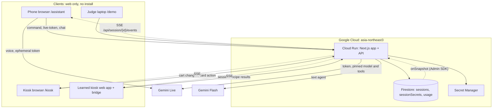
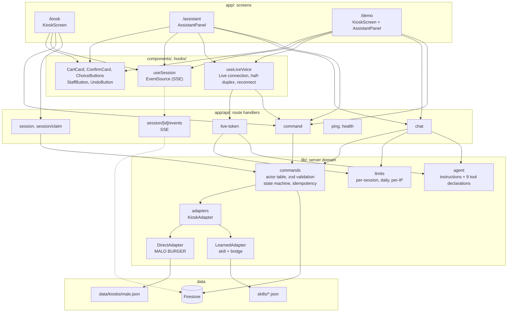
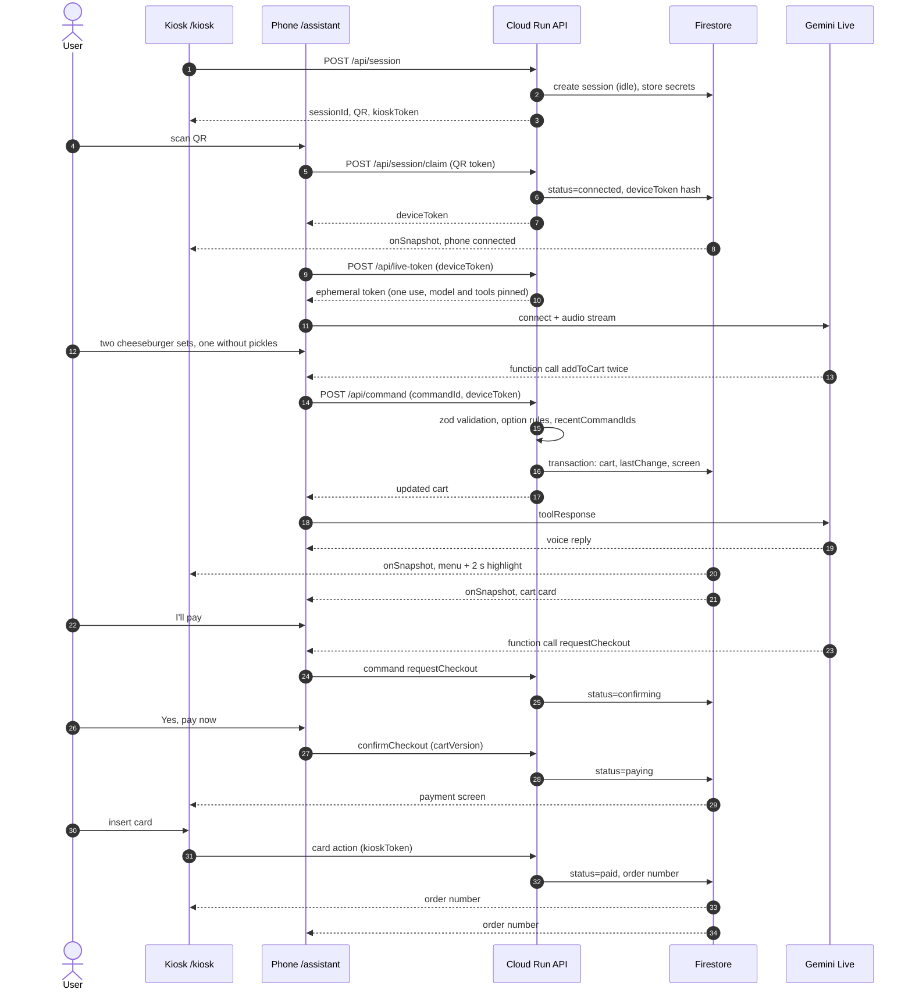
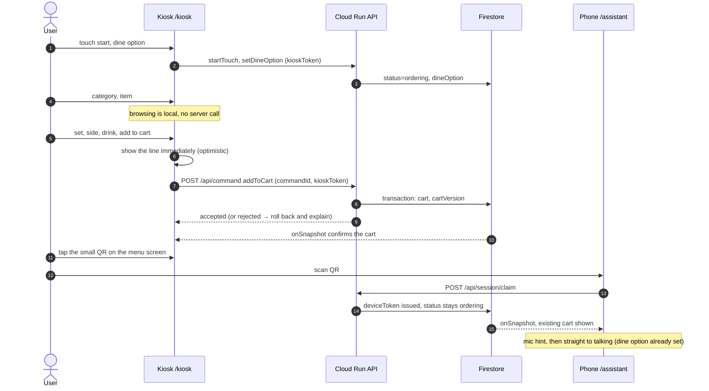
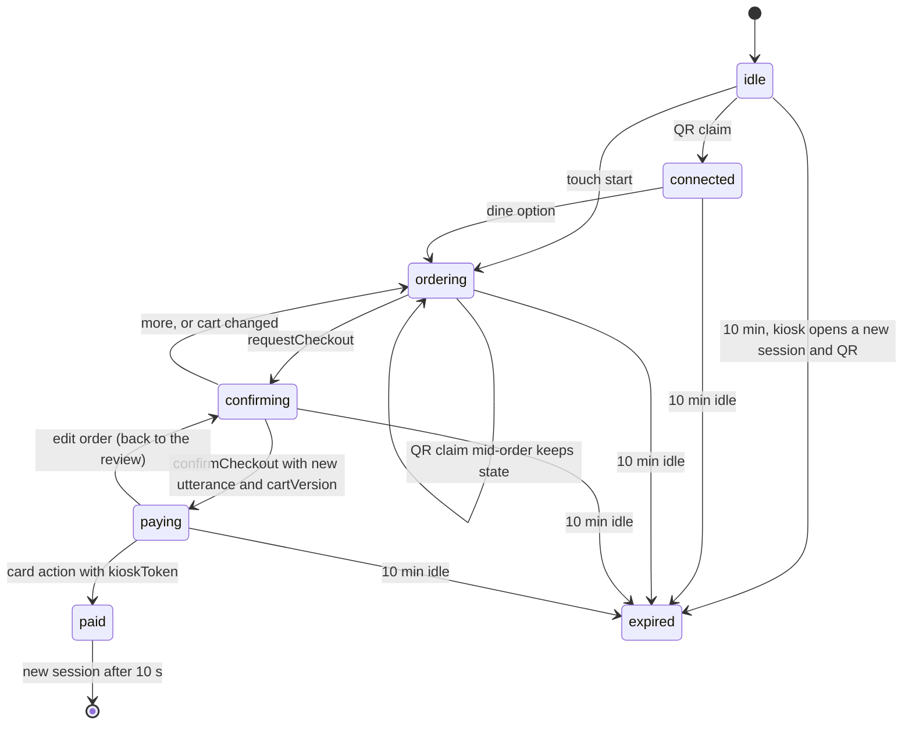

# Architecture

## Directory structure (planned)
```
src/
├── app/
│   ├── kiosk/            # MALO BURGER kiosk simulator (portrait)
│   ├── assistant/        # phone UI opened from the QR
│   ├── demo/             # judge mode: kiosk + assistant side by side
│   ├── learn/            # /learn, /learn/<runId>: replays of recorded KIBO Learn runs (public/learn/)
│   ├── learned/          # /learned/<kioskId>: the learned kiosk page (public/learned-kiosks/, unchanged) in a same-origin iframe + KIBO's panel and tap marks; the bridge drives it
│   └── api/
│       ├── session/      # create session, claim QR token; [id]/events = SSE stream of the session
│       ├── command/      # every state change (AI tools, phone buttons, kiosk touch)
│       ├── live-token/   # ephemeral token for Gemini Live
│       ├── chat/         # text agent (fallback and /demo text input)
│       └── ping/, health/
├── components/           # CartCard, ConfirmCard, ChoiceButtons, StaffButton, UndoButton, kiosk screens
├── hooks/                # useSession (EventSource on the SSE route), useLiveVoice (Live, half-duplex, reconnect)
├── lib/
│   ├── agent/            # instructions + 9 tool declarations, shared by voice and text
│   ├── commands/         # actor table, zod validation, state machine, idempotency
│   ├── store/            # SessionStore interface: FirestoreStore (production), MemoryStore (tests, local E2E)
│   ├── session/          # create, claim, run command, ping: store transaction + state machine
│   ├── adapters/         # KioskAdapter: DirectAdapter (MALO), LearnedAdapter (skill + bridge)
│   ├── bridge/           # browser bridge for learned kiosks: tappable labels, recipe replay, total and line checks
│   └── limits/           # per-session, per-day and per-IP limits
└── types/
data/kiosks/malo.json     # direct-adapter menu with option groups and upsell rules
data/kiosks/airport_rail.json  # direct-adapter ticket machine (fictional airport rail), pictograms in public/kiosks/airport_rail/
skills/*.json             # learned kiosk skills (committed after human review)
learner/                  # KIBO Learn (offline, Playwright)
```

## Deployment


## Application architecture (code modules)

Screens share components; every state change goes through `lib/commands`; the agent definition in `lib/agent` is shared by voice and text.



## Patterns
- Server Components by default; Client Components only for interactive screens and Firestore subscriptions.
- All writes through `POST /api/command` with `commandId`, actor token and zod-validated arguments; Firestore transaction; `recentCommandIds` (last 30) for idempotency, and `sessionSecrets.recentResults` (last 10) so a retry gets the first `result`.
- Clients never touch Firestore (ADR-010). They read the session through `GET /api/session/{id}/events` (SSE), which the server feeds from a Firestore `onSnapshot` listener. Firestore rules deny every client read and write.
- Storage goes through `lib/store` (`SessionStore`). `STORE=firestore` in production; `STORE=memory` for unit tests and local E2E (single process only). Domain code uses epoch milliseconds for times; FirestoreStore writes `expiresAt` as a Firestore Timestamp so the TTL policy can delete it.
- Agent definitions live once in `lib/agent` and are used by both the Live session (pinned via the token) and `/api/chat`.

## Data flow (voice order)
```
User speaks → Gemini Live (phone) → function call → POST /api/command
→ validate (actor, schema, catalog, state) → Firestore transaction (cart, lastChange, screen)
→ server-side onSnapshot → SSE → kiosk moves to the category and highlights the line for 2 s; phone updates the cart card
```

## Sequence diagrams
In these diagrams `FS-->>K: onSnapshot` is shorthand: the server's Firestore listener pushes the new session over the screen's SSE stream (ADR-010).

### 1. Voice order (Flow A)


### 2. Touch order, then switching to voice mid-order (Flow B)
Browsing stays local; taps that change the session (start, dine option, cart, checkout) go to the server, and the kiosk shows cart changes before the server answers (optimistic update).


### 3. Order on a learned kiosk (KIBO Learn bridge)
The kiosk's own screen is the source of truth; the session mirrors it after each verified replay.
```mermaid
sequenceDiagram
  autonumber
  participant P as Phone /assistant
  participant API as Cloud Run API
  participant FS as Firestore
  participant B as Bridge script in kiosk page
  participant KU as Kiosk UI
  P->>API: POST /api/command addToCart (deviceToken)
  API->>API: validate against skill catalog, forbidden labels
  API->>FS: queue command for the bridge
  FS-->>B: onSnapshot, next command
  B->>KU: check current screen (restart order if idle)
  B->>KU: replay recipe: category, item, options, add
  KU-->>B: kiosk total and cart lines
  alt total and lines match
    B->>API: report success (kioskToken)
    API->>FS: cart mirrored, lastChange
    FS-->>P: onSnapshot, cart card
  else mismatch or step failed
    B->>KU: close dialogs, read the cart
    B->>API: report failure (kiosk total and lines)
    API->>FS: change not applied, staff called (learned_mismatch); kiosk text never stored
    FS-->>P: "Please check the kiosk screen"
  end
```

## Session state machine


## API

### Routes
| Route | Who calls it | What it does |
|---|---|---|
| `POST /api/session` | Kiosk or bridge | New session + QR + `kioskToken` |
| `POST /api/session/claim` | Phone | Exchanges the one-use QR token for a `deviceToken` |
| `POST /api/session/pair` | Phone (`/app`) | Exchanges the kiosk's 6-digit pairing code for a `deviceToken`, like a claim |
| `POST /api/command` | Phone (AI tools, buttons), kiosk (touch, card), bridge | Every state change; `commandId` required |
| `POST /api/live-token` | Phone | How voice starts: an ephemeral Gemini Live token, or the Vertex relay's address when the API key cannot serve voice (ADR-012); checks limits |
| `POST /api/chat` | Phone, `/demo` | Text agent (Gemini Flash function-calling loop) |
| `GET /api/session/{id}/events` | Phone, kiosk, bridge, `/demo` | SSE stream: the public session JSON on connect and after every change; a comment line every 25 s keeps the connection open; the server ends the stream after 15 min and `EventSource` reconnects; screens close it when hidden for 60 s, and the phone and `/demo` also when idle for 20 min, and reopen a refused one (429, 503) after a growing wait ("Limits and cost") |
| `POST /api/ping` | Phone, kiosk | 30 s heartbeat with an "active in the last 30 s" flag; the kiosk pings in touch-only sessions. The phone also pings with `working` when a typed or spoken turn goes to the AI and when it is answered, for the kiosk's "KIBO is working…" |
| `GET /api/health` | Monitoring | Liveness; `?deep=1` also checks the store, that both Gemini model ids are served, that the text backend and the API key can still spend, and the voice relay when `VOICE_RELAY_URL` is set (uptime check, `docs/plan/OPERATIONS.md` "Deploy") |

Pages: `/kiosk?k=<kioskId>` (`&demo=1` shows the tap counter and timer; on a landscape screen, such as a laptop standing in for the kiosk, the unchanged portrait canvas is as tall as the screen and KIBO's slim status column (`src/components/pairing/PairingPanel.tsx`) sits beside it, both centred. The QR and the pairing code are only on the kiosk's own screen (K1 and its QR sheet), never repeated in the column (14-final:1); the column has three steps ("Scan the QR on the kiosk, or open `<host>/app` (or the `SHORT_APP_URL` host) and type the code shown there", …), the phone status from `phoneConnectedAt` and `phoneSeenAt` ("Waiting for a phone", "Phone connected at <time>", "Connection paused"), then a read-only status line from the public session (`orderLine` in `src/lib/kiosk/pairing.ts`: step, item count, total; `changeLine`: who made the last change, and from the review on "Waiting for you to confirm", "Confirmed by you", "Paid at the kiosk · confirmed by you", never the AI; `kioskStep`: the Korean kiosk's review, payment and receipt step in English, e.g. "Tap 카드 (Card), then 카드 넣기 (Insert card)"; no transcript). After a reissued QR it waits again at once. Portrait screens show the canvas alone), `/assistant?s=<sessionId>#t=<claim>` (token in the fragment, removed from the URL right after claiming), `/demo` (creates a session with `demo: true` and claims it in the same page, so it holds both tokens; its kiosk half shows no tap counter and no [Connect another phone], which would void the page's own phone. D1's [Use my phone instead] creates `demo: true, pairPhone: true` instead: the page holds only the kiosk token, shows the status column in place of the phone half, and the judge's own phone claims the session by the kiosk half's QR or code; the demo limits still apply, [Connect another phone] is shown, the scenario guide lists its sentences as text to say (no chips, no [Play it for me]), there is no touch-vs-talk card (the counts happen on the other phone), and [Try again] makes a fresh pairable session), `/learned/<kiosk>/` (the unchanged learned page, at the learner's 1080 width but laid out 1120–1600 tall so it draws as large as fits (`pageFrame`, `src/lib/bridge/replayView.ts`), beside KIBO's panel with the QR and pairing code; the bridge hands each click's label and box to the page through `onTap` before it clicks, the host draws a numbered mark there and waits 350 ms, which `replayMs` leaves out, and `replayCaption` says "✓ matches" only after the server's `bridgeStatus` for that command; 14-final:3), `/learn` and `/learn/<runId>` (replays of recorded KIBO Learn runs, no AI and no API calls: `npm run learn:runs` copies a learner trace from `spikes/` to `public/learn/<runId>/`, its screenshots as WebP ≤ 60 KB and a `run.json` with the turns (tool, tapped labels, recorded names and one-line results only), the grade summary and the source paths; `src/lib/learn/`), `/mic-test` (development only, not linked: microphone permission check on real phones), `/app` (the installable phone app's home, P0: `src/app/manifest.ts` served as `/manifest.webmanifest` with `start_url` `/app`; settings in `localStorage` (`src/lib/phone/settings.ts`): `kibo.phone.locale`, `kibo.phone.aiLang` (an AI-only language from `/assistant`'s picker, empty otherwise; `/app`'s Korean/English choice clears it), `kibo.phone.aiVoice`, `kibo.phone.largeText`, and `kibo.phone.lastOrder` (session id, status and expiry only) for [Continue my order]; its code field sends the kiosk's 6-digit pairing code to `POST /api/session/pair`, stores the device token under `kibo.phone.<sessionId>` as a QR claim does, and opens `/assistant?s=<id>`), `/app/scan` (the kiosk QR read by the phone camera inside the web app after a tap: `BarcodeDetector` or `jsqr` on in-memory canvas frames, about 8 a second; only this app's own `/assistant?s=…#t=…` is accepted (`parseKioskQr`, `src/lib/phone/kioskQr.ts`) and opened rebuilt from its checked parts; the only page whose `Permissions-Policy` allows `camera=(self)`, everywhere else `camera=()`). `public/sw.js` is registered by `/app` and `/assistant` in production builds with scope `/app`: it caches only `/offline.html` and answers only `/app` navigations without a network, so `/api`, the session streams and `/assistant` never pass through it (`npm run pwa:check` on a production build). Installing is optional; a kiosk's QR link works in any browser.

### Common rules
- JSON over HTTPS, body ≤ 64 KB (a chat history of Korean text needs more than 16 KB), every body parsed with a zod schema before anything else.
- Actor token in `Authorization: Bearer <deviceToken|kioskToken>`. The server stores only SHA-256 hashes and compares in constant time. Tokens are 32 random bytes, base64url.
- Success: `{ "ok": true, ... }`. Failure: `{ "ok": false, "error": { "code", "message", "detail"? } }`. `message` is plain words a user can read (heuristic 9); no stack traces, ids or model text.
- `message` stays plain English, for the AI, logs and as a fallback; the server never translates it. Screens show their own ko/en copy chosen by `error.code` (and `detail.templateId`) with `errorCopy` in `src/lib/i18n/errors.ts`, which also covers the client-side `NETWORK` (no answer).

| Code | HTTP | When |
|---|---|---|
| `BAD_REQUEST` | 400 | zod failure, unknown command type, value out of range |
| `UNAUTHORIZED` | 401 | missing or wrong actor token |
| `FORBIDDEN` | 403 | actor may not send this command (table below) |
| `NOT_FOUND` | 404 | no such session; a pairing code that matches no live, unclaimed kiosk session ("That code doesn't match a kiosk. Check the number on the kiosk screen.") |
| `CONFLICT` | 409 | wrong session state, stale `cartVersion`, another phone already claimed the session ("Someone else is using this kiosk"), a learned-kiosk command still pending |
| `GONE` | 410 | session expired |
| `NEEDS_CHOICE`, `SOLD_OUT`, `UNAVAILABLE` | 422 | catalog rule failed; `error.detail` lists the missing group or alternatives so the AI can call `offerChoices` |
| `RATE_LIMITED` | 429 | per-session, daily or per-IP limit (see Limits) |
| `UPSTREAM` | 502 | Gemini error; the phone falls back to text |
| `INTERNAL` | 500 | any other server error; the log records only the error name |

### Endpoints
| Route | Request | Response |
|---|---|---|
| `POST /api/session` | `{ kioskId, demo?, pairPhone? }` | `{ sessionId, claimUrl, kioskToken, expiresAt, pairCode, pairUrl }` (`pairCode`: 6 digits, for the kiosk screen only; `pairUrl`, with every `pairCode`: the address the kiosk shows beside it, `SHORT_APP_URL` when set, else "<`PUBLIC_ORIGIN` host>/app"; text only, never a link); with `demo: true` also `deviceToken` and no `pairCode` (the session is claimed from the start). With `demo: true, pairPhone: true` (`/demo` "Use my phone instead") no `deviceToken` but a `pairCode`: a demo session (demo limits) that stays `idle` until a real phone claims it by QR or code; `pairPhone` without `demo` is `BAD_REQUEST`. `claimUrl`'s origin is `PUBLIC_ORIGIN` when set, else the request's forwarded host |
| `POST /api/session/claim` | `{ sessionId, claimToken }` | `{ deviceToken, status }`. A second claim gets `CONFLICT`; the same phone reconnects with its stored `deviceToken` instead of claiming again |
| `POST /api/session/pair` | `{ code }` (exactly 6 digits, else `BAD_REQUEST`) | `{ sessionId, deviceToken, status }`, the same result as a claim. `CONFLICT` "Someone else is using this kiosk." when a phone already holds the session, `GONE` when it expired, `NOT_FOUND` for a wrong, used, rotated or over-an-hour-old code. A code works once: the claim clears it from `sessionSecrets` and then deletes `pairCodes/{code}`. 10 attempts per minute per address (`RATE_LIMITED`), bad bodies included |
| `POST /api/command` | `{ sessionId, commandId (string, 1–128), type, args, cartVersion?, utteranceSeq?, source: "voice"\|"text"\|"button"\|"touch" }`. `source` is bound to the actor: the phone sends `voice`, `text` or `button`, the kiosk (and the learned-kiosk bridge) only `touch`; anything else is `BAD_REQUEST`. `commandId`: `<liveSessionId>:<functionCallId>` for voice, `<chatRequestId>:<n>` for text, a uuid for buttons and touch | `{ ok, status, cart, total, cartVersion, dineOption, result? }` (`dineOption` since 14-final:4: the voice model learns a dine option a tap set after its instructions were pinned, I-224); a repeated `commandId` returns the current state with `duplicate: true` and applies nothing, with the first response's `result` when it is among the last 10 kept in `sessionSecrets.recentResults` (else `{}`); `reissueClaim` also returns `claimUrl` and a new `pairCode` (the old code stops working and its entry is deleted), and a repeated `reissueClaim` (before `paying`) rotates again and returns a fresh one, because the first token is never stored |
| `POST /api/live-token` | `{ sessionId, locale, language? }` + device token (`language`: one of `ja`, `zh`, `es`, `vi`, `fr`, `th`, `id`, sent only when the phone's AI language is not its screen locale; it sets the instructions' language and the transcription code; the relay's hello takes the same field) | `{ mode: "relay", url }` when the voice goes through the Vertex relay (ADR-012: `GEMINI_LIVE_BACKEND=vertex`, or `auto` while the key cannot generate); the same checks as a token (`UNAUTHORIZED`, `FORBIDDEN`, `GONE`, `CONFLICT`, a spent session `RATE_LIMITED`), but nothing is counted here, the relay counts when the phone connects; `vertex` without `VOICE_RELAY_URL` is `UPSTREAM`. Otherwise `{ mode: "direct", token, model, expiresAt, voiceSeconds }` (model, instructions with the current cart, tools, audio replies, transcription with `languageCodes` from `locale` (`ko-KR`/`en-US`) and end of speech after 700 ms of silence pinned in the token); before `paying` only (`CONFLICT`); over a limit `RATE_LIMITED` "Voice is busy right now. Please type instead." |
| `POST /api/chat` | `{ sessionId, chatRequestId (uuid), message (≤ 500 chars), history (last 10 turns of user and model text, kept on the phone; tool turns are rejected), utteranceSeq, cartVersion? (the version shown on the confirm card), locale, language? (as on `/api/live-token`) }` + device token | `{ reply, status, cart, total, cartVersion, actions }` after ≤ 5 tool rounds (since 14-final:5 a plain request in the screens' language whose first-round calls all succeeded, all of them `setDineOption`, `addToCart`, `updateCart`, `removeFromCart`, `undoLastChange`, `requestCheckout` or `confirmCheckout` with no upsell, on a direct kiosk, and with no model text beside them, gets its `reply` from fixed ko/en sentences over the results and menu data instead of a second model call (`quickReply`, `src/lib/agent/quickReply.ts`); a question, another language, a failure, a choice, a staff call, an upsell or a learned kiosk keeps the model's reply); `actions` lists each tool call of the request as `{ tool, args, code, pending?, ms }` (`tool` is a declared name or `unknown`, `args` only ids and numbers plus the line's `itemId` for line tools, `code` `ok` or the error code, `ms` around the command; never a message, model text or token; `src/lib/agent/actions.ts`), shown only on `/demo` ("What the AI did"); Gemini Live tool calls report the same shape on the phone; choice buttons come from `pendingChoice` in the stream. One request is one user utterance: every command in it carries the request's `utteranceSeq`, so `confirmCheckout` is refused in the request that ran `requestCheckout` |
| `POST /api/ping` | `{ sessionId, active, working? }` | `{ status, expiresAt, serverTime }`; `active: true` extends the session; `serverTime` lets screens correct for clock offset; `working` from the phone sets `phoneWorkingAt` to now (`true`) or null (`false`), from the kiosk it is ignored, and a ping without it leaves the field as it is |
| `GET /api/session/{id}/events` | — | SSE; each change is `data: <public session JSON>`; an unknown or deleted session gets one `event: gone` (`data: {}`) and the stream closes, so the client should close its `EventSource`. If the server's Firestore listener fails, the stream ends without `gone` and `EventSource` reconnects |
| `GET /api/health` | — | `{ ok, service, version, store, revision, time }`. With `?deep=1`: `{ ok, checks: { store, textModel, liveModel, textGenerate, keyGenerate, liveToken, liveRelay } }` (each `ok` or `fail`; a store `get` of an id that never exists must return null; `models.get` for each model id on the Gemini API (Vertex AI refuses it with 403); `textGenerate` and `keyGenerate`: a 1-output-token `generateContent` through the text backend and on the API key, which fail when billing does; `liveToken`: a one-use ephemeral token with a 60 s expiry, discarded. Lookups and tokens are free and kept passing with the key's credits used up, 10-13, I-104. 5 s timeout each, result cached 60 s per instance), `liveRelay`: the relay's `GET /health` when `VOICE_RELAY_URL` is set, else `off`; while it is `ok`, a failing `keyGenerate` does not fail the check, because voice still works (ADR-012), and it stays in the body. 200 when all pass, else 503 |

### Commands and actors
`type` in `/api/command`. The AI tools ("Agent tools" below) are the phone's commands; the kiosk adds touch and payment commands. On a learned kiosk the bridge in the kiosk page acts as the kiosk, with the `kioskToken`.

| Command | Phone | Kiosk | State rule |
|---|---|---|---|
| `startTouch` | | ✓ | `idle → ordering`; in `connected` or `ordering` accepted without a change |
| `setDineOption` | ✓ | ✓ | `connected → ordering` (kiosk also from `idle`), or update in `ordering` or `confirming`; a change in `confirming` adds 1 to `cartVersion`, because the confirm card shows the dine option. `BAD_REQUEST` on a kiosk without `dineOptions` (tickets); `offerChoices` with a dine choice is refused there too |
| `addToCart`, `updateCart`, `removeFromCart` | ✓ | ✓ | `ordering`; from `connected` the first cart change moves to `ordering` (the dine option can come later; `requestCheckout` asks for it); in `confirming` the change sends the session back to `ordering` |
| `clearCart` | | ✓ | `ordering` or `confirming` → `ordering` with an empty cart (kiosk "clear all") |
| `undoLastChange` | ✓ | ✓ | not in `paying` or `paid` |
| `offerChoices` | ✓ | | any state before `paying` |
| `callStaff` | ✓ | ✓ | any state except `expired`; the only command accepted in `paid` |
| `requestCheckout` | ✓ | ✓ | `ordering → confirming`; refused when the cart is empty (`CONFLICT`); on a kiosk with `dineOptions` and no dine option chosen it returns `NEEDS_CHOICE` with the two dine choices (a kiosk without `dineOptions` never asks); records `checkoutAt` and `checkoutUtteranceSeq` (the phone command's `utteranceSeq`; null from the kiosk or without one) |
| `cancelCheckout` | ✓ | ✓ | `confirming → ordering`, cart unchanged ([Pick more], kiosk back button) |
| `confirmCheckout` | ✓ | ✓ | `confirming → paying`; needs matching `cartVersion`. From the phone: either `source: "button"` (a tap on the confirm card) or an AI call when the phone's AI opened the review: `checkoutUtteranceSeq` is not null, `utteranceSeq > checkoutUtteranceSeq`, and at least 1.5 s after `checkoutAt`. A review the kiosk opened or `editOrder` reopened has a null `checkoutUtteranceSeq`, so the phone must tap the card (an AI confirm gets `CONFLICT` "Please confirm on the card."). From the kiosk: `source: "touch"` |
| `editOrder` | | ✓ | `paying → confirming` (back to the review); sets `checkoutUtteranceSeq` to null and `checkoutAt` to now |
| `cardAction` | | ✓ | `paying → paid`; issues the order number. Refused for learned kiosks (the user pays on the real kiosk). `/demo` sends it from the kiosk half of the page with the demo's `kioskToken` |
| `reissueClaim` | | ✓ | any state before `paying`: new claim token and QR, the old `deviceToken` stops working ([Connect another phone]) |
| `bridgeReport` | | ✓ | learned kiosks only (`CONFLICT` on a direct kiosk). Args `{ commandId, ok, kioskTotal (int ≥ 0 \| null), kioskLines (≤ 20 × ≤ 120 chars) }`; `commandId` must be the pending one (`CONFLICT`). The server applies the pending change to its own cart with menu data; if `ok` and `kioskTotal` equals that cart's total, the change is applied (`lastChange.source` = the original command's source) and `bridgeStatus.lastOk` is true. Otherwise nothing is applied, `staffCalled` is `learned_mismatch` and `bridgeStatus.lastOk` is false. `kioskLines` are third-party page text: bounded, never stored (the bridge compares lines itself). The report keeps `pendingChoice` |

- `utteranceSeq` is the phone's counter of finished user turns. On voice, speech transcribed while a model response runs counts only if that response is interrupted; when it completes, the speech was a late chunk of the sentence it answered and counts for nothing (half-duplex mutes the mic while the AI speaks; I-151, `src/lib/voice/turns.ts`). With the 1.5 s wait it stops the model from chaining `requestCheckout` and `confirmCheckout` in one turn; the confirm card is still the real safeguard. In `/api/chat` one request counts as one utterance. The server only knows a seq the phone's AI sent with `requestCheckout`; when the kiosk opened the review or `editOrder` reopened it, no later utterance can be proven, so only a tap on the card confirms.
- A tap on a choice button is sent to the agent as the user's answer (the button's label, counted as a new utterance), because the agent holds the half-finished order the question belongs to; the agent then calls the tool. Dine choices send `setDineOption` directly, and the confirm card's [Yes, pay now] sends `confirmCheckout` with `source: "button"`. Any accepted command except `bridgeReport` clears `pendingChoice`.
- **Learned kiosks:** `setDineOption`, `addToCart` and `removeFromCart` are validated as on a direct kiosk, then stored in `pendingBridgeCommand` without changing the session and answered `{ ok: true, pending: true, status, cart, total, cartVersion }` (`result.pending`); the phone waits for the bridge's `bridgeReport` through `onSnapshot`. After 15 s without a report the phone shows "Please check the kiosk screen" and offers staff. While one is pending, those three, `undoLastChange` and `requestCheckout` get `CONFLICT` "The kiosk is still working on your last request."; a pending command older than 20 s counts as failed (cleared, `learned_mismatch`, `bridgeStatus.lastOk` false), also when its late report arrives. `updateCart` gets `CONFLICT` "On this kiosk, please remove the item and add it again."; `undoLastChange` works only when the last change was an add that made a new line, and becomes a pending `removeFromCart` of it. Learned sessions end at `confirming`: `confirmCheckout`, `editOrder`, `cardAction` and `clearCart` get `CONFLICT` "Please finish and pay on the kiosk screen.", and the user pays on the kiosk itself. Nothing is retried automatically.

### `/api/command` processing order
1. Parse with zod (`BAD_REQUEST`); `sessionId` must match `^[A-Za-z0-9_-]{16,64}$` (the same check on every route that takes one).
2. In one Firestore transaction read `sessions/{id}` and `sessionSecrets/{id}`.
3. Match the token hash to an actor (`UNAUTHORIZED`), check the actor table (`FORBIDDEN`) and the actor's allowed `source` (`BAD_REQUEST`).
4. If `commandId` is in `recentCommandIds`, return the current state with the stored `result` from `sessionSecrets.recentResults`, write nothing (except a repeated `reissueClaim`, which rotates the claim again).
5. Check the state machine (`CONFLICT`, `GONE`).
6. Validate against the adapter's catalog: item exists, options belong to the item, required groups, min/max, hours, sold out (`NEEDS_CHOICE`, `SOLD_OUT`, `UNAVAILABLE`).
7. For commands that change the cart: build the new cart (prices and total come from menu data, never from arguments), `cartVersion + 1`, push the old cart on `undoStack`, set `lastChange`. On a learned kiosk a cart change waits in `pendingBridgeCommand` and is built this way only when the matching `bridgeReport` arrives. For every accepted command: set `status` and `screen`, clear `pendingChoice` (not on `bridgeReport`), append `commandId`, extend `expiresAt`.
8. Commit. Firestore retries the transaction on contention, so touch and AI changes at the same moment serialize instead of overwriting each other.

## Database (Firestore)
Firestore Native mode in `asia-northeast3` (the location cannot be changed later). Menus are not in the database (ADR-009). All access is by document id, so no composite indexes are needed.

### `data/kiosks/{kioskId}.json` (repo, read-only)
```
kind: "direct", domain (food|ticket), brand, hero? (K1 picture: photo, or SVG on the theme tint), theme{colors, panel? (rail and toolbar; default cream)}, locale (default), locales[] (ko|en the kiosk screen offers on K1's language row, reset to `locale` for each new session; default ["ko"]),
dineOptions?{eat_in, take_out: {name{ko,en}, image}} (absent: the kiosk never asks eat-in or take-out),
vocabulary?{item, add, cart: name{ko,en}} (domain words; default 메뉴/menu, 담기/Add, 장바구니/Cart), categories[],
items[{itemId, name{ko,en}, subtitle?{ko,en}, category, image (/menu/ photo or /kiosks/<kioskId>/ pictogram), kcal (int | null: hidden), badge (best|new|null), allergens[] (may be empty), soldOut,
       availableHours ("HH:MM-HH:MM" KST | null),
       variants[{variant: single|set|largeSet, price}],
       optionGroups[{groupId, name{ko,en}, appliesTo[variant], required, min, max, defaultOptionIds[],
         options[{optionId, name{ko,en}, image?, priceDelta (may be negative: a child fare), soldOut}]}]}],
upsellRules[{whenCategory | whenItemId, offerItemIds}]   (upsell once per order; may be empty)
```
A required group with `defaultOptionIds` (the set side: medium fries) takes the default when the order does not say; a required group without defaults (the set drink) is rejected with `NEEDS_CHOICE` so the AI asks. The kiosk sheet preselects defaults. Prices are multiples of 10, and no valid selection may bring a unit price below 0; the catalog tests check both for every kiosk (`allKioskIds()`). Learned kiosks normalize to `domain: "food"`, `locales: [locale]`.

### `skills/{kioskId}.json` (learned, reviewed, committed)
```
kioskId, kind: "learned", brand{ko,en}, locale, currency, page (/learned-kiosks/<kiosk>/index.html, the kiosk page copied unchanged),
provenance{learnedBy, evidence, reviewed}, dineOptions{eat_in, take_out: exact kiosk labels},
categories[{categoryId, name{ko,en}, label}],
catalog[{itemId, name{ko,en}, label, category, price, soldOut,
         optionGroups[{groupId, name{ko,en}, label, required, min, max, defaultOptionIds[], options[{optionId, name{ko,en}, label, priceDelta}],
                       select?[steps] (how chooseOptions picks one option, e.g. the + in its row), after?[steps] (e.g. a wizard's 다음)}]}],
uiLabels[], forbiddenLabels[] (a label containing any entry is never clicked: payment, card, checkout),
checkout{label, name{ko,en}} (the kiosk's own button that ends the order, one of the forbidden labels; the phone's review says "tap 주문하기 on the kiosk and pay there"),
recipes{startOrder, addToCart, removeLine, ...}, cartTotalPattern, cartLinePattern
```
Recipe steps: `click`, `check`, `clickIfVisible`, `clickNth` on a `label`, `role`+`name` or `text`, optionally narrowed by `within` (the match whose closest ancestor holds that text); `forEach`, `repeat`, and `chooseOptions` (per option group of the item, its `select` steps or the op's own steps for each chosen option, then its `after` steps; one group id means the same steps on every item). Added in 13-blind-kiosks:4 (`spikes/kibo-learn/CHANGES.md`); `skills/doughhouse.json` uses none of them.
`label` is the exact text the kiosk shows; ids (ASCII snake_case) and `name.en` are added during human review. `skillSchema` (`src/lib/adapters/learned.ts`) checks it (names ≤ 40 chars, single line, no `<` or `>`, integer prices); `learnedToKiosk` normalizes it into the items shape (one `single` variant per item, a neutral placeholder image, no upsell rules) plus `learned` (page, recipes, labels by id, group steps by id) for the bridge.

### `sessions/{sessionId}` — server only; clients read it through the SSE route (ADR-010)
| Field | Type | Notes |
|---|---|---|
| `sessionId` | string | the document id, repeated so the SSE JSON is self-contained |
| `kioskId` | string | which menu or skill |
| `demo` | bool | created by `/demo` (both tokens on one page) |
| `status` | `idle\|connected\|ordering\|confirming\|paying\|paid\|expired` | state machine above |
| `dineOption` | `eat_in\|take_out\|null` | |
| `cart` | array of `{ lineId, itemId, variant, qty (1–10), selections{groupId: optionId[]}, unitPrice }` | ≤ 20 lines; ids only, screens take names from menu data |
| `total` | int (KRW) | computed by the server |
| `cartVersion` | int | +1 on every cart change |
| `phoneConnectedAt`, `phoneSeenAt` | epoch ms \| null | set by claim and phone pings; the kiosk shows "phone connected" and, after 60 s without a ping, "connection paused" |
| `phoneWorkingAt` | epoch ms \| null | the phone's last `working: true` ping, null after `working: false`; the kiosk's toolbar row says "KIBO is working…" while it is under 20 s old and the order is before `paying` (`kiboWorking`, `src/lib/kiosk/timers.ts`). Absent on sessions stored before 14-final:1 |
| `screen` | `{ category?, itemId? }` | what the kiosk should show |
| `lastChange` | `{ lineId (null for undo and clear), kind: add\|update\|remove\|undo\|clear, source: voice\|text\|button\|touch, at }` | drives the 2 s highlight and the status line ("Added by AI", "Changed by AI"); AI wording only for `voice` and `text` |
| `pendingChoice` | `{ templateId, choices[{ kind: item\|variant\|option\|dine\|yesno, id }] } \| null` | question text and labels come from templates and menu data, never free text |
| `staffCalled` | `{ reasonCode: unknown_info\|user_request\|stuck\|learned_mismatch, at } \| null` | fixed banner text on the kiosk; no free text in a public document |
| `undoStack` | last 5 carts | |
| `recentCommandIds` | last 30 strings | idempotency |
| `checkoutUtteranceSeq`, `checkoutAt` | int \| null, timestamp | set by `requestCheckout` (seq null when the kiosk opened the review); `editOrder` sets the seq to null and `checkoutAt` to now |
| `upsellOffered` | bool | the dessert offer is made once per order: the first accepted `addToCart` that matches an upsell rule sets it and returns `result.upsell { offerItemIds }`, which the kiosk (touch) and the AI both use |
| `orderNumber`, `paidAt` | int, timestamp | set by `cardAction` |
| `pendingBridgeCommand` | `{ commandId, type: setDineOption\|addToCart\|removeFromCart, args, lineIndex? (remove: the line's position), source, at } \| null` | learned kiosks, one at a time; ids and catalog values only |
| `bridgeStatus` | `{ lastOk, at } \| null` | learned kiosks: the bridge's last result, for the phone's "Please check the kiosk screen" |
| `createdAt`, `lastSeenAt`, `expiresAt` | timestamp | TTL deletes on `expiresAt` |

Worst case (20 lines × 6 carts) stays far below the 1 MiB document limit. Sessions hold no personal data: the session id is printed in a public QR, so anyone holding it can read the cart.

### `sessionSecrets/{sessionId}` — server only
`claimTokenHash`, `claimed`, `deviceTokenHash`, `kioskTokenHash`, `recentResults` (last 10 `{ commandId, result }` of commands that returned a `result`, so a retry gets the same `lineId` or `upsell`; `reissueClaim` is kept with an empty result, never its claim token or pairing code), `pairCode` (the kiosk's current 6 digits, null once used, absent on `/demo` sessions; kept as digits because a hash of 6 digits would protect nothing, and a rotation must find the old entry to delete it), `chatCount`, `liveTokenCount`, `createdAt`, `expiresAt` (TTL). The per-session limits count here, where no client can see or change them.

### `pairCodes/{code}` — server only
`{ sessionId, expiresAt }` (Timestamp, TTL), one per live code; the document id is the 6 digits. Written by `POST /api/session` and `reissueClaim` in a transaction that refuses a code a live entry holds (`expiresAt` in the future; an expired entry the TTL has not deleted yet is replaced), with up to 5 draws. `expiresAt` is one hour after the code was issued; a code works only while it is also the session's current `sessionSecrets.pairCode` and the session is live and unclaimed. Deleted after a successful pairing and when `reissueClaim` replaces it; the TTL removes the rest.

### `usage/{yyyy-mm-dd}` (KST) — server only
`voiceSessions`, `chatMessages`, incremented with `FieldValue.increment` inside the limit check. Per-IP limits are kept in memory per Cloud Run instance; with `max-instances=3` the effective limit is at most 3× the configured value.

### Security rules
```
rules_version = '2';
service cloud.firestore {
  match /databases/{db}/documents {
    match /{document=**} { allow read, write: if false; }
  }
}
```
Clients read sessions only through the SSE route (ADR-010).
The server uses the Admin SDK with the runtime service account, which bypasses these rules.

## Agent tools (9)
Mutating tools return the updated cart, so no separate summary tool is needed. The catalog is in the instructions, so no lookup tools.

| Tool | Role | UX reason |
|---|---|---|
| `setDineOption(option)` | Dine-in / take-out | A4 |
| `addToCart(itemId, variant, qty, selections)` | Add; server checks option rules (required, counts, hours, sold out) and price. Missing choices come back structured so the AI can call `offerChoices` | A6 |
| `updateCart(lineId, changes{qty?, variant?, selections?})` | **Edit an existing line** ("make the fries large") | A7 |
| `removeFromCart(lineId)` | Remove | |
| `undoLastChange()` | Revert the last change; the phone's [Undo] uses the same path | Heuristic 3 |
| `offerChoices(templateId, choices[{kind, id}])` | Show choice buttons (catalog ids only; the server builds the question and labels) | Heuristic 6 |
| `callStaff(reasonCode)` | Unanswerable question or stuck user; fixed banner text on the kiosk | Data principle |
| `requestCheckout()` | Open the confirm card (`confirming`) | A8 |
| `confirmCheckout()` | Accepted only in `confirming`, with matching `cartVersion`, after a new user utterance on a review the AI opened; a review the kiosk opened or reopened needs a tap on the card | Heuristic 5 |

Learned kiosks support `setDineOption`, `addToCart`, `removeFromCart`, `requestCheckout`, `offerChoices`, `callStaff`; `updateCart` becomes remove + add, `undoLastChange` only undoes the last add. They have no `confirmCheckout`: after `requestCheckout` the instructions tell the AI to send the user to the kiosk's own checkout button and never to offer to pay (I-100).

A kiosk without `dineOptions` (the airport rail ticket machine) gets no `setDineOption`, and `offerChoices` there has no `pick_dine` template or `dine` choice kind; `addToCart`'s `variant` lists only the variants the catalog sells. The instructions follow the kiosk's `domain` (`src/lib/agent/instructions.ts`): a `ticket` kiosk talks about tickets, destinations and passengers, adds one line per passenger type, asks for an unclear destination (`pick_item`) and a transit card's top-up, and calls staff (`unknown_info`) for platforms, timetables, delays, luggage and connections. Dine and upsell lines appear only on kiosks whose data has them. Example sentences per kiosk: `examplesFor(kioskId, locale)` in `src/lib/agent/examples.ts`.

Anti-hallucination: names, prices and options exist only in menu data; the server validates every argument; the cart card and confirm screen are rendered from session state, never from model text.

## Voice
- **Gemini Live (default).** The phone connects directly with an ephemeral token: `uses: 1`, short `newSessionExpireTime`, model, instructions and tools pinned via `liveConnectConstraints`; issued only to a valid `deviceToken`, counted per session.
- **Which path (ADR-012, `src/lib/agent/liveBackend.ts`).** `GEMINI_LIVE_BACKEND`: `auto` (default) gives a direct token while the API key can generate and the relay's address (`VOICE_RELAY_URL`) when it cannot: a 402 or no key, seen by the token issuer or by a probe (one output token through `generateContent` on the key with `GEMINI_TEXT_MODEL`, because ephemeral tokens are free and kept working with the credits used up, I-104), cached 60 s when the key works and 10 min when it does not, per instance; other probe errors (429, 5xx, network) say nothing about billing and keep the direct path. `api` is direct only; `vertex` is the relay only. `auto` without `VOICE_RELAY_URL` stays direct. The phone (`useLiveVoice`, `src/lib/voice/relayLink.ts`) handles both with the same message handling, audio and tool runner: in relay mode it opens a browser `WebSocket`, sends the hello, starts its countdown from the relay's `voiceSeconds`, and wraps its sends as `{ realtimeInput | clientContent | toolResponse: … }`. A relay refusal (`4401`, `4403`, `4404`, `4409`, `4410`, `4429`, `4502`, `4400`) ends voice with the same copy as a refused token; `4000` is "voice time is up"; a drop (`1006`, `1011`, `4408`, `4500`) reconnects through `/api/live-token`, which can send the phone back to the direct path once the key works again.
- **Vertex relay (built 12-phone-app:8, used by the phone since 12-phone-app:9, first deployed 10-13 by the orchestrator as `kibo-voice-00001-6kz`).** `kibo-voice`, a second Cloud Run service (`voice-relay/`), because Vertex AI Live has no ephemeral tokens and Next.js route handlers cannot accept WebSockets. The browser opens `wss://<kibo-voice>/ws`; its first message is `{ sessionId, deviceToken, locale }`. The relay runs `issueLiveToken` with an issuer that opens Vertex Live (`us-central1`, the runtime service account) instead of minting a token, so the checks, budgets (per session, per address per day, daily) and the pinned config (`liveConfig`, `liveConnectConfig`) are the token path's own code, and a failed open gives the counts back. Then it sends `{ relay: { model, expiresAt, voiceSeconds } }`, forwards Live's messages unchanged as JSON, and forwards only the browser's `realtimeInput`, `clientContent` and `toolResponse` (a `setup` or anything else is dropped). It closes both sides together, also when the voice time runs out (`4000` "Voice time is up."). A refused start closes with `4000 + HTTP status` of the error code and its plain message (`4401`, `4403`, `4404`, `4409`, `4410`, `4429`, `4502`; `4400` bad hello, `4408` no hello in 10 s); a Live close mid-session is `1011`. `GET /health` for checks. One local run on 10-13 (`npm run voice:relay-check`, one text turn, Vertex `us-central1`): socket to setup complete 3,265 ms, first audio 794 ms after the turn was sent, turn complete 4,327 ms, 9,133 tokens.
- **Languages (14-final:4).** The phone's language picker (app bar) offers Korean and English, which change the screens too, and Japanese, Chinese (Simplified), Spanish, Vietnamese, French, Thai and Indonesian, for which the screens stay English and only the AI speaks and writes the language (`src/lib/i18n/languages.ts`; stored as `kibo.phone.aiLang`). The phone sends it as `language` to `/api/live-token`, the relay and `/api/chat`; the instructions say to speak the chosen language and to answer in whatever language the user speaks or writes, and never to translate item names (names stay `name.en`, or `name.ko` for Korean). The transcription code comes from the same table (`ja-JP`, `cmn-CN`, `es-ES`, `vi-VN`, `fr-FR`, `th-TH`, `id-ID`); each opened a session and got a reply in its language on the Gemini API and on Vertex AI `us-central1` (`evidence/live-languages.json`, typed turn only). The phone translates only the mic label, [Yes, pay now], [Pick more], "Insert your card into the kiosk" and the order number, and shows each cart line's Korean name with the English one under it. Kiosk subtitles stay English.
- **Dine option told to an open session (14-final:4, I-224).** The phone often opens voice on P1, before P2's eat-in tap, so the token's order says "not chosen". Every tool result carries `dineOption`, and when a tap sets it while Live is open the phone sends one `clientContent` turn with `turnComplete: false` starting "Note from the phone:" (`src/lib/voice/dineNote.ts`), which the instructions name as not the user's words. It counts as no utterance.
- **Recognition settings** (pinned in the token): `inputAudioTranscription.languageCodes` set from the phone locale (`ko-KR` or `en-US`), and end of speech after 700 ms of silence with high end-of-speech sensitivity (`realtimeInputConfig.automaticActivityDetection`). In an offline comparison on synthetic voices, `languageCodes` removed the dropped and wrong-language short answers ("네") and two menu-item swaps in noise at the same latency, and Korean key-term recall rose from 96.6% to 97.1% clean, 93.7% to 95.4% noisy (`spikes/voice-compare/RESULTS.md`). The shorter silence is meant for short answers that waited 3.5–8.9 s there; its effect is unverified (the hero voice runs still pass, 10-13). `customVocabulary` and menu names in the instruction did not change the transcript, so neither is set.
- **Decision test:** 10 Korean and English utterances; accept if first audio reply ≤ 2 s and ≥ 9/10 menu names recognized. If Live fails it, the demo uses the text agent (Fallback below).
- **Reconnect:** fetch a new token automatically; the new session's instructions include the current cart marked "already applied"; after two failures switch to text.
- **iOS:** prepare audio playback on the first mic tap (no sound without a user gesture); echo cancellation and half-duplex.
- **One conversation:** while a Live session is open, a typed line, an example or a choice tap goes to it as one user turn (`sendClientContent`), not to `/api/chat`, so the voice model sees every change. Typed and spoken turns share one `utteranceSeq` counter on the phone (I-079). A typed turn through `sendClientContent` got a tool call from `gemini-3.8-live` on 10-13 (manual check, no saved log).
- **Fallback:** if Live is not stable by 2026-10-14, demo with the text agent (`/api/chat`), which is built first.
- Model ids are environment variables so a deprecated preview model can be swapped without code changes: `GEMINI_LIVE_MODEL=gemini-3.8-live` (fallback `gemini-3.1-flash-live-preview`), `GEMINI_TEXT_MODEL=gemini-3.8-flash` (ADR-011).

## Limits and cost
- `/demo` per session: 3 min of voice, 30 messages; then [Try again].
- Daily: 200 voice sessions; after that text only. `/api/chat`: 60 messages per session, 3,000 per day.
- Live tokens: one use; a new Live connection must start within 60 s (`newSessionExpireTime`); `expireTime` is 3 min for `/demo` and 10 min otherwise, returned as `voiceSeconds` so the phone also stops on its own timer (whether `expireTime` closes an open connection is unverified). At most 2 tokens per `/demo` session and 6 per phone session (each reconnect needs one), counted in `sessionSecrets.liveTokenCount`. A token counts only when it was created: a request in `paying` or later gets `CONFLICT` before anything is counted, and when the issuer fails the session, address and daily counts are given back (I-150).
- Per IP: 240 API requests per minute (pings, stream opens, commands and chat; raised from 60 on 10-13 because judges may share one office address and one `/demo` order is about 13 requests, I-154, `phases/11-hardening/LOAD.md`), 10 new sessions per minute and 10 pairing-code attempts per minute (`POST /api/session/pair`; with a few live codes out of 1,000,000, one address needs on the order of 10,000 minutes to hit one, own calculation), keyed on the **last** `X-Forwarded-For` value (the one Cloud Run appends); an IPv6 address counts by its /64 prefix, since one client can rotate addresses inside it.
- Per IP and KST day: 24 Live tokens and 300 `/api/chat` messages, so one address cannot spend the day's shared 200 and 3,000 (sessions are free; I-148). Chat counts every request that passes the per-minute check and the body check, before the token is checked. `RATE_LIMITED` "Voice is busy right now. Please type instead." and "You've reached today's message limit. Please use the buttons.". Judges behind one office address share these (I-154).
- Per IP: at most 40 open session streams (`GET /api/session/{id}/events`) at once, released once when a stream ends in any way (the request's abort, the reader's cancel, a failed write, the 15 min cap, `gone`, a listener error; I-206); the 41st gets `RATE_LIMITED` "Too many open screens. Please close one and try again." (I-149). Raised from 10 on 10-13 after judges behind one address saw `/demo` stuck on "Connecting to the kiosk…" (I-154); 40 stays far below Cloud Run's 80 × 3 = 240 request slots. A screen holds one stream, `/demo` two. `EventSource` gives up on such a reply, so the screen reopens the stream after 3 s, 6 s, 12 s, … up to 30 s while visible and not paused (the wait starts again after an open), and meanwhile says "Busy right now. Reconnecting…" (the kiosk: "잠시 후 다시 연결합니다…"; `useSessionStream` state `retrying`, I-033). The reply's message cannot be shown: `EventSource` does not expose it.
- Open streams (12-phone-app:7): an open SSE request keeps a Cloud Run instance billed as active (on 10-13 about KRW 4,350 per instance per day against about KRW 820 idle; billing console, no saved file). So the server ends every stream after 15 min (a final `: stream end` comment; `EventSource` reconnects on a screen in use), and Cloud Run's request timeout is 900 s, above that cap (was 3,600 s). On the client (`useSessionStream`, `src/lib/client/streamControl.ts`) a tab hidden for 60 s closes its stream and reopens it when visible, and a phone or `/demo` screen with no session change and no pointer or key input for 20 min closes it and shows "Paused · Tap to continue" until tapped. Kiosk screens (`/kiosk`, `/learned/*`, `/demo` "Use my phone instead") never pause while visible (12-phone-app:10, I-172), because a kiosk waits on K1 for a phone and a learned kiosk's bridge replays from the stream; a visible kiosk tab therefore holds its instance active, so close kiosk tabs after a demo. A paid order on the phone and on `/demo` keeps its screen without the layer. No polling replaces the stream.
- All per-IP counts live in memory per Cloud Run instance, so with `max-instances=3` one address gets at most 3× each value.
- These are starting values; adjust them after the cost-per-session measurement (`docs/TESTING.md`).
- Input ≤ 500 characters, ≤ 5 tool rounds per request, capped output tokens.
- **Prompt cache (text agent, since 11-hardening:2):** the static instructions (rules and menu, `chatInstructions` in `src/lib/agent/instructions.ts`) and the tools go into one explicit Gemini context cache per backend, model, kiosk and locale, created on first use with a 60 min TTL and replaced 5 min before it expires (`src/lib/agent/cache.ts`, in memory per instance). Each `/api/chat` call names the cache; the order (status, dine option, cart) is never cached and goes in a `<current_order>` block at the start of the latest user message. When a backend refuses a cache (too small, unsupported), the call is sent inline, one log line names the status, and that cache is not retried for 10 min; a cached call refused with 400, 403 or 404 is sent once inline. Cache names stay on the server. Text input cost per hero order fell 85% before storage, with no latency gain (`evidence/prompt-cache.json`). Gemini Live cannot name a cache, so voice keeps its instructions in the token.
- Cloud Run `max-instances=3`; Gemini per-minute quota capped in GCP. Budget alerts notify but never stop spending, so these caps are the real limit.
- On HTTP 429 from Gemini: "Please try again in a moment" and switch to text.

## Region and secrets
- Cloud Run and Firestore in `asia-northeast3`; always pass `--region` (local gcloud defaults elsewhere).
- The text agent (`/api/chat`) runs with `GEMINI_TEXT_BACKEND=auto` since 10-13 (8-scenarios:0): each request starts on the Gemini API key, which was faster (I-105), and only when that call fails with 402 (prepaid credits used up, I-104), 429 or a 5xx/network error is the same call sent once to Vertex AI (location `global`, billed to the GCP billing account, the runtime service account's credentials, no key). After 3 × 402 within 5 minutes an instance uses Vertex directly for 10 minutes. One request stays on the backend its first call used, so a backend never changes after a tool ran and nothing is retried after a command was applied (`src/lib/agent/model.ts`). Voice keeps the same Gemini API key from Secret Manager, because ephemeral tokens are a Gemini API feature; when the key's prepaid credits run out, voice goes through the `kibo-voice` relay on Vertex AI Live instead (ADR-012, "Voice"). The offline learner uses Vertex AI locally.
- Dedicated runtime service account with only `datastore.user`, `secretmanager.secretAccessor` and `aiplatform.user`.

## Environment variables
| Name | Where | Value |
|---|---|---|
| `GEMINI_API_KEY` | `.env` locally; Secret Manager `gemini-api-key` on Cloud Run | server only, never sent to a browser. Voice (ephemeral tokens), the deep health's key checks, and the text agent with `auto` or `api` |
| `GEMINI_TEXT_BACKEND` | env | `auto` (default: the Gemini API key, falling back once per call to Vertex AI on 402, 429 or 5xx/network errors; see "Region and secrets"), `api` (the key only) or `vertex` (Vertex AI only, with application default credentials: the runtime service account on Cloud Run, `gcloud auth application-default login` locally) |
| `GEMINI_VERTEX_LOCATION` | env | Vertex AI location for the text agent, default `global` |
| `GEMINI_TEXT_MODEL`, `GEMINI_LIVE_MODEL` | env | ADR-011 |
| `GEMINI_LIVE_BACKEND` | env | `auto` (default: direct Gemini Live tokens on the API key, the Vertex relay while the key cannot generate), `api` (direct only) or `vertex` (relay only); ADR-012, "Voice" |
| `VOICE_RELAY_URL` | env | the `wss://…/ws` address of `kibo-voice` (`ws://` locally); anything else counts as not set. Without it `auto` stays direct and `vertex` refuses voice. `scripts/deploy.sh` passes it when set in the deploying shell |
| `VOICE_VERTEX_LOCATION` | env (`kibo-voice` only) | Vertex AI location for the voice relay, default `us-central1` (the only location that served `gemini-3.8-live` on 10-13, orchestrator check) |
| `GEMINI_TEXT_THINKING` | env | text agent thinking level: `low` (default), `medium` or `high`; `gemini-3.8-flash` rejects `minimal`. `low` was chosen for latency (I-059, `evals/results/2026-10-13T01-38.md`); temperature stays the model default |
| `STORE` | env | `firestore` (default when `NODE_ENV=production`) or `memory` (default otherwise; tests, local E2E, `npm run qa:ui`). In production `memory` is refused unless `ALLOW_MEMORY_STORE=1` (single instance only) |
| `GOOGLE_CLOUD_PROJECT` | env | `kibo-2026` (also the Vertex AI project); locally the Admin SDK uses gcloud application default credentials |
| `PUBLIC_ORIGIN` | env | the origin in claim URLs and in the kiosk's "<host>/app" line; `scripts/deploy.sh` sets the deterministic service URL `https://kibo-<project number>.asia-northeast3.run.app`, so every kiosk shows one host. Unset locally: the request's forwarded host (`publicOrigin` in `src/lib/http.ts`) |
| `SHORT_APP_URL` | env, optional | a bare lowercase host (e.g. `kibo-2026.web.app`, a Firebase Hosting redirect to `/app`, `firebase.json`) that the kiosk shows beside the pairing code instead of "<host>/app" (`pairUrl` in `src/lib/http.ts`); anything with a scheme, port, path or capitals is ignored with one log line. Display only: QR codes and claim URLs keep `PUBLIC_ORIGIN`. Read per request, so it changes without a rebuild; `scripts/deploy.sh` passes it when set in the deploying shell |

## State management
- Shared order state: Firestore session document (server-written).
- Local UI state: kiosk navigation, open sheets, mic state (React state).
- Conversation history: phone memory only, never stored on the server.

## KIBO Learn
```
learn (offline): kiosk URL → explore (accessibility tree + tappable labels) → record findings
→ write skill (catalog + recipes) → self-test with the AI-free runner (≥3 orders) → audit → human review → commit
run (per order): tool call → validate against skill catalog → bridge replays recipe in page
→ verify kiosk total and cart lines → write session; on mismatch stop, re-read cart, offer staff/touch
```
Prototype and results: `spikes/kibo-learn/`, `spikes/blind-kiosk/`.
