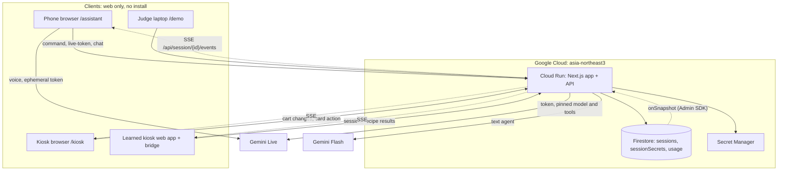
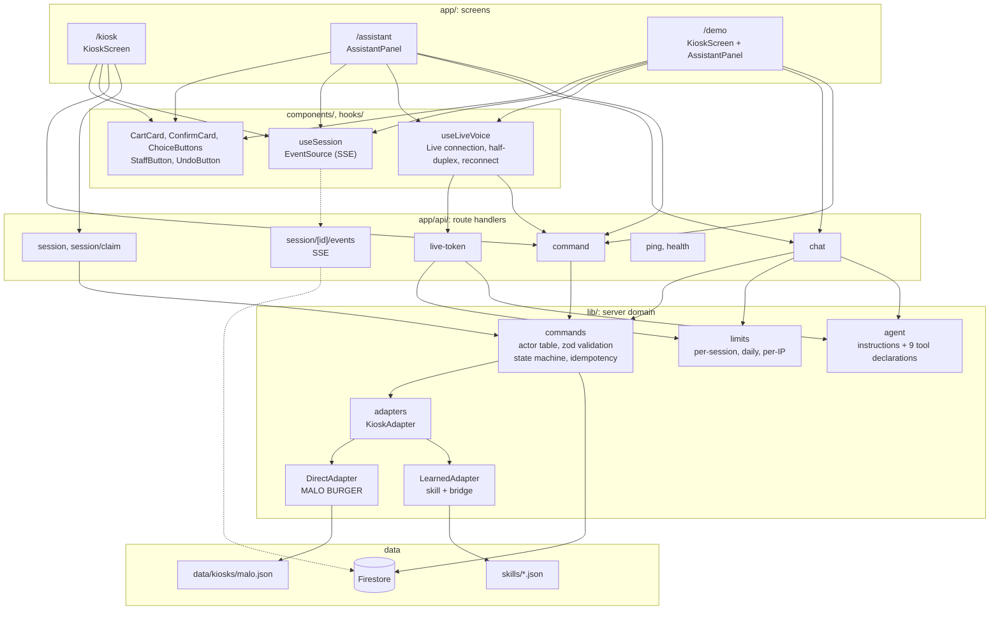
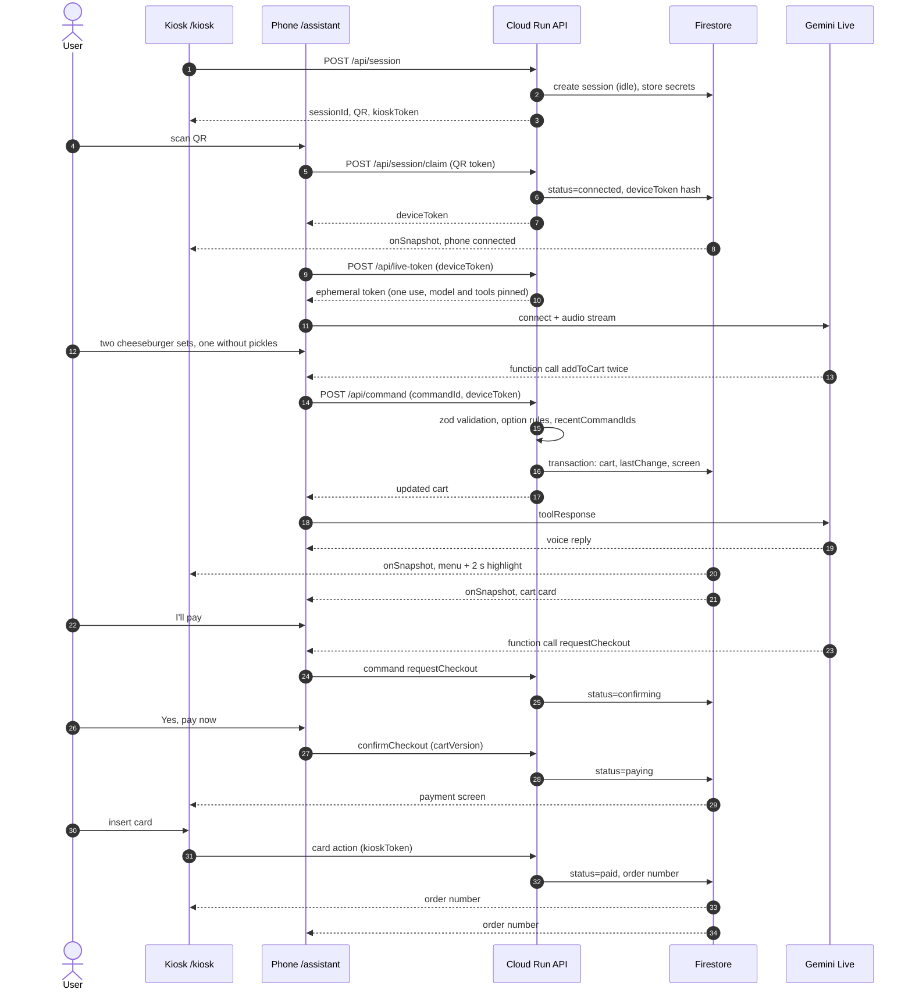
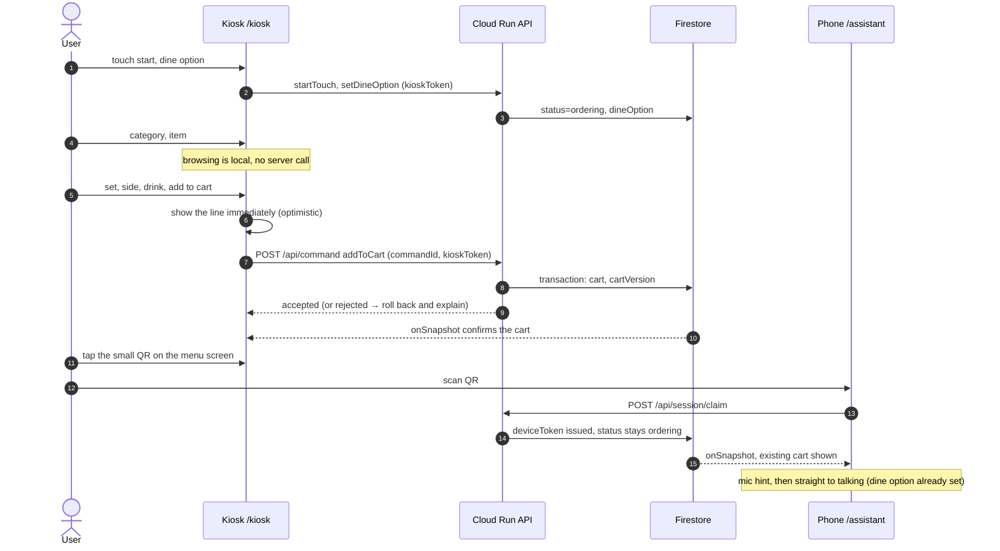
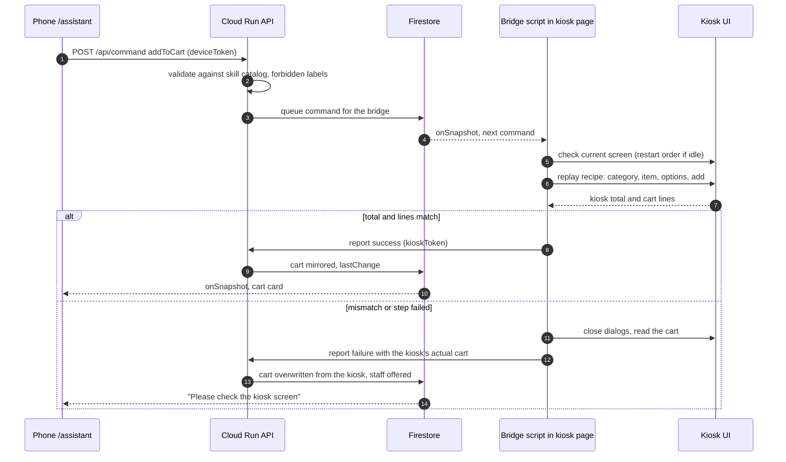
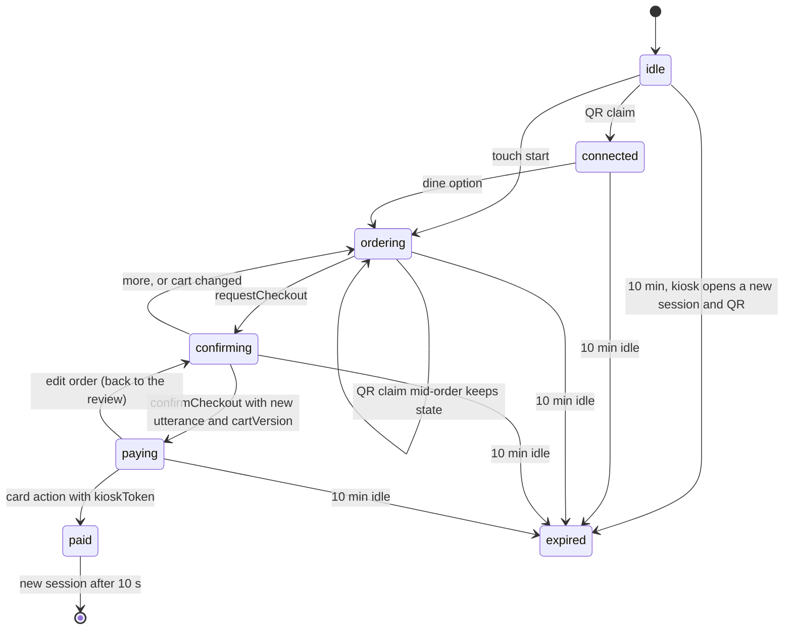

# Architecture

## Directory structure (planned)
```
src/
├── app/
│   ├── kiosk/            # MALO BURGER kiosk simulator (portrait)
│   ├── assistant/        # phone UI opened from the QR
│   ├── demo/             # judge mode: kiosk + assistant side by side
│   ├── learned/          # static learned kiosks (doughhouse, gureum) + bridge script
│   └── api/
│       ├── session/      # create session, claim QR token; [id]/events = SSE stream of the session
│       ├── command/      # every state change (AI tools, phone buttons, kiosk touch)
│       ├── live-token/   # ephemeral token for Gemini Live
│       ├── chat/         # text agent (fallback and /demo text input)
│       └── ping/, health/
├── components/           # CartCard, ConfirmCard, ChoiceButtons, StaffButton, UndoButton, kiosk screens
├── hooks/                # useSession (EventSource on the SSE route), useLiveVoice (Live, half-duplex, reconnect)
├── lib/
│   ├── agent/            # instructions + 9 tool declarations, shared by voice and text
│   ├── commands/         # actor table, zod validation, state machine, idempotency
│   ├── store/            # SessionStore interface: FirestoreStore (production), MemoryStore (tests, local E2E)
│   ├── session/          # create, claim, run command, ping: store transaction + state machine
│   ├── adapters/         # KioskAdapter: DirectAdapter (MALO), LearnedAdapter (skill + bridge)
│   └── limits/           # per-session, per-day and per-IP limits
└── types/
data/kiosks/malo.json     # direct-adapter menu with option groups and upsell rules
skills/*.json             # learned kiosk skills (committed after human review)
learner/                  # KIBO Learn (offline, Playwright)
```

## Deployment


## Application architecture (code modules)

Screens share components; every state change goes through `lib/commands`; the agent definition in `lib/agent` is shared by voice and text.



## Patterns
- Server Components by default; Client Components only for interactive screens and Firestore subscriptions.
- All writes through `POST /api/command` with `commandId`, actor token and zod-validated arguments; Firestore transaction; `recentCommandIds` (last 30) for idempotency.
- Clients never touch Firestore (ADR-010). They read the session through `GET /api/session/{id}/events` (SSE), which the server feeds from a Firestore `onSnapshot` listener. Firestore rules deny every client read and write.
- Storage goes through `lib/store` (`SessionStore`). `STORE=firestore` in production; `STORE=memory` for unit tests and local E2E (single process only). Domain code uses epoch milliseconds for times; FirestoreStore writes `expiresAt` as a Firestore Timestamp so the TTL policy can delete it.
- Agent definitions live once in `lib/agent` and are used by both the Live session (pinned via the token) and `/api/chat`.

## Data flow (voice order)
```
User speaks → Gemini Live (phone) → function call → POST /api/command
→ validate (actor, schema, catalog, state) → Firestore transaction (cart, lastChange, screen)
→ server-side onSnapshot → SSE → kiosk moves to the category and highlights the line for 2 s; phone updates the cart card
```

## Sequence diagrams
In these diagrams `FS-->>K: onSnapshot` is shorthand: the server's Firestore listener pushes the new session over the screen's SSE stream (ADR-010).

### 1. Voice order (Flow A)


### 2. Touch order, then switching to voice mid-order (Flow B)
Browsing stays local; taps that change the session (start, dine option, cart, checkout) go to the server, and the kiosk shows cart changes before the server answers (optimistic update).


### 3. Order on a learned kiosk (KIBO Learn bridge)
The kiosk's own screen is the source of truth; the session mirrors it after each verified replay.


## Session state machine


## API

### Routes
| Route | Who calls it | What it does |
|---|---|---|
| `POST /api/session` | Kiosk or bridge | New session + QR + `kioskToken` |
| `POST /api/session/claim` | Phone | Exchanges the one-use QR token for a `deviceToken` |
| `POST /api/command` | Phone (AI tools, buttons), kiosk (touch, card), bridge | Every state change; `commandId` required |
| `POST /api/live-token` | Phone | Ephemeral Gemini Live token; checks limits |
| `POST /api/chat` | Phone, `/demo` | Text agent (Gemini Flash function-calling loop) |
| `GET /api/session/{id}/events` | Phone, kiosk, bridge, `/demo` | SSE stream: the public session JSON on connect and after every change; a comment line every 25 s keeps the connection open; `EventSource` reconnects when Cloud Run ends the request |
| `POST /api/ping` | Phone, kiosk | 30 s heartbeat with an "active in the last 30 s" flag; the kiosk pings in touch-only sessions |
| `GET /api/health` | Monitoring | Liveness; later also probes token issue and a tiny Gemini call |

Pages: `/kiosk?k=<kioskId>` (`&demo=1` shows the tap counter and timer), `/assistant?s=<sessionId>#t=<claim>` (token in the fragment, removed from the URL right after claiming), `/demo` (creates a session with `demo: true` and claims it in the same page, so it holds both tokens), `/learned/<kiosk>/`, `/mic-test` (development only, not linked: microphone permission check on real phones).

### Common rules
- JSON over HTTPS, body ≤ 64 KB (a chat history of Korean text needs more than 16 KB), every body parsed with a zod schema before anything else.
- Actor token in `Authorization: Bearer <deviceToken|kioskToken>`. The server stores only SHA-256 hashes and compares in constant time. Tokens are 32 random bytes, base64url.
- Success: `{ "ok": true, ... }`. Failure: `{ "ok": false, "error": { "code", "message", "detail"? } }`. `message` is plain words a user can read (heuristic 9); no stack traces, ids or model text.

| Code | HTTP | When |
|---|---|---|
| `BAD_REQUEST` | 400 | zod failure, unknown command type, value out of range |
| `UNAUTHORIZED` | 401 | missing or wrong actor token |
| `FORBIDDEN` | 403 | actor may not send this command (table below) |
| `NOT_FOUND` | 404 | no such session |
| `CONFLICT` | 409 | wrong session state, stale `cartVersion`, another phone already claimed the session ("Someone else is using this kiosk"), a learned-kiosk command still pending |
| `GONE` | 410 | session expired |
| `NEEDS_CHOICE`, `SOLD_OUT`, `UNAVAILABLE` | 422 | catalog rule failed; `error.detail` lists the missing group or alternatives so the AI can call `offerChoices` |
| `RATE_LIMITED` | 429 | per-session, daily or per-IP limit (see Limits) |
| `UPSTREAM` | 502 | Gemini error; the phone falls back to text |

### Endpoints
| Route | Request | Response |
|---|---|---|
| `POST /api/session` | `{ kioskId, demo? }` | `{ sessionId, claimUrl, kioskToken, expiresAt }`; with `demo: true` also `deviceToken` |
| `POST /api/session/claim` | `{ sessionId, claimToken }` | `{ deviceToken }`. A second claim gets `CONFLICT`; the same phone reconnects with its stored `deviceToken` instead of claiming again |
| `POST /api/command` | `{ sessionId, commandId (string, 1–128), type, args, cartVersion?, utteranceSeq?, source: "voice"\|"text"\|"button"\|"touch" }`. `commandId`: `<liveSessionId>:<functionCallId>` for voice, `<chatRequestId>:<n>` for text, a uuid for buttons and touch | `{ ok, status, cart, total, cartVersion, result? }`; a repeated `commandId` returns the current state with `duplicate: true` and applies nothing |
| `POST /api/live-token` | `{ sessionId }` | `{ token, expiresAt }` (model, instructions and tools pinned in the token) |
| `POST /api/chat` | `{ sessionId, message (≤ 500 chars), history (last 10 turns of user and model text, kept on the phone; tool turns are rejected) }` | `{ reply, status, cart, total, choices? }` after ≤ 5 tool rounds. One request is one user utterance: `confirmCheckout` is refused in the request that ran `requestCheckout` |
| `POST /api/ping` | `{ sessionId, active }` | `{ status, expiresAt }`; `active: true` extends the session |
| `GET /api/health` | — | `{ ok, version }` |

### Commands and actors
`type` in `/api/command`. The AI tools ("Agent tools" below) are the phone's commands; the kiosk adds touch and payment commands. On a learned kiosk the bridge in the kiosk page acts as the kiosk, with the `kioskToken`.

| Command | Phone | Kiosk | State rule |
|---|---|---|---|
| `startTouch` | | ✓ | `idle → ordering` |
| `setDineOption` | ✓ | ✓ | `connected → ordering`, or update in `ordering` |
| `addToCart`, `updateCart`, `removeFromCart` | ✓ | ✓ | `ordering`; in `confirming` the change sends the session back to `ordering` |
| `clearCart` | | ✓ | `ordering` or `confirming` → `ordering` with an empty cart (kiosk "clear all") |
| `undoLastChange` | ✓ | ✓ | not in `paying` or `paid` |
| `offerChoices` | ✓ | | any state before `paying` |
| `callStaff` | ✓ | ✓ | any state |
| `requestCheckout` | ✓ | ✓ | `ordering → confirming`; refused when the cart is empty; records `checkoutUtteranceSeq` and `checkoutAt` |
| `cancelCheckout` | ✓ | ✓ | `confirming → ordering`, cart unchanged ([Pick more], kiosk back button) |
| `confirmCheckout` | ✓ | ✓ | `confirming → paying`; needs matching `cartVersion`. From the phone: either `source: "button"` (a tap on the confirm card) or an AI call with `utteranceSeq > checkoutUtteranceSeq` and at least 1.5 s after `checkoutAt` |
| `editOrder` | | ✓ | `paying → confirming` (back to the review) |
| `cardAction` | | ✓ | `paying → paid`; issues the order number. Refused for learned kiosks (the user pays on the real kiosk). `/demo` sends it from the kiosk half of the page with the demo's `kioskToken` |
| `reissueClaim` | | ✓ | any state before `paying`: new claim token and QR, the old `deviceToken` stops working ([Connect another phone]) |
| `bridgeReport` | | ✓ | learned kiosks only: mirrors the kiosk's real cart (sequence 3) |

- `utteranceSeq` is the phone's counter of finished user turns. With the 1.5 s wait it stops the model from chaining `requestCheckout` and `confirmCheckout` in one turn; the confirm card is still the real safeguard. In `/api/chat` one request counts as one utterance.
- A tap on a choice button sends the command the choice stands for (for example `addToCart` with the chosen id) with `source: "button"`. Any accepted command clears `pendingChoice`.
- **Learned kiosks:** a cart command is stored in `pendingBridgeCommand` and answered `{ ok: true, pending: true }`; the phone waits for the bridge's `bridgeReport` through `onSnapshot`. After 15 s without a report the phone shows "Please check the kiosk screen" and offers staff. A second command while one is pending gets `CONFLICT`. Learned sessions end at `confirming`: the user pays on the kiosk itself.

### `/api/command` processing order
1. Parse with zod (`BAD_REQUEST`).
2. In one Firestore transaction read `sessions/{id}` and `sessionSecrets/{id}`.
3. Match the token hash to an actor (`UNAUTHORIZED`), check the actor table (`FORBIDDEN`).
4. If `commandId` is in `recentCommandIds`, return the current state, write nothing.
5. Check the state machine (`CONFLICT`, `GONE`).
6. Validate against the adapter's catalog: item exists, options belong to the item, required groups, min/max, hours, sold out (`NEEDS_CHOICE`, `SOLD_OUT`, `UNAVAILABLE`).
7. For commands that change the cart: build the new cart (prices and total come from menu data, never from arguments), `cartVersion + 1`, push the old cart on `undoStack`, set `lastChange`. For every accepted command: set `status` and `screen`, clear `pendingChoice`, append `commandId`, extend `expiresAt`.
8. Commit. Firestore retries the transaction on contention, so touch and AI changes at the same moment serialize instead of overwriting each other.

## Database (Firestore)
Firestore Native mode in `asia-northeast3` (the location cannot be changed later). Menus are not in the database (ADR-009). All access is by document id, so no composite indexes are needed.

### `data/kiosks/{kioskId}.json` (repo, read-only)
```
brand, theme{colors, logo}, locale, categories[],
items[{itemId, name{ko,en}, category, image, kcal, badge (best|new|null), allergens[], soldOut,
       availableHours ("HH:MM-HH:MM" KST | null),
       variants[{variant: single|set|largeSet, price}],
       optionGroups[{groupId, name{ko,en}, appliesTo[variant], required, min, max, defaultOptionIds[],
         options[{optionId, name{ko,en}, image?, priceDelta, soldOut}]}]}],
upsellRules[{whenCategory | whenItemId, offerItemIds}]   (upsell once per order)
```
A required group with `defaultOptionIds` (the set side: medium fries) takes the default when the order does not say; a required group without defaults (the set drink) is rejected with `NEEDS_CHOICE` so the AI asks. The kiosk sheet preselects defaults.

### `skills/{kioskId}.json` (learned, reviewed, committed)
```
catalog, categories, uiLabels, dineOptions, recipes{startOrder, addToCart, ...}, cartTotalPattern, cartLinePattern
LearnedAdapter normalizes the catalog into the items shape: ids generated from labels, name.en added during human review.
```

### `sessions/{sessionId}` — clients: `get` and `onSnapshot` only; server writes
| Field | Type | Notes |
|---|---|---|
| `kioskId` | string | which menu or skill |
| `status` | `idle\|connected\|ordering\|confirming\|paying\|paid\|expired` | state machine above |
| `dineOption` | `eat_in\|take_out\|null` | |
| `cart` | array of `{ lineId, itemId, variant, qty (1–10), selections{groupId: optionId[]}, unitPrice }` | ≤ 20 lines; ids only, screens take names from menu data |
| `total` | int (KRW) | computed by the server |
| `cartVersion` | int | +1 on every cart change |
| `phoneConnectedAt`, `phoneSeenAt` | epoch ms \| null | set by claim and phone pings; the kiosk shows "phone connected" and, after 60 s without a ping, "connection paused" |
| `screen` | `{ category?, itemId? }` | what the kiosk should show |
| `lastChange` | `{ lineId, source: voice\|text\|button\|touch, at }` | drives the 2 s highlight; "Added by AI" only for `voice` and `text` |
| `pendingChoice` | `{ templateId, choices[{ kind: item\|variant\|option\|dine\|yesno, id }] } \| null` | question text and labels come from templates and menu data, never free text |
| `staffCalled` | `{ reasonCode: unknown_info\|user_request\|stuck\|learned_mismatch, at } \| null` | fixed banner text on the kiosk; no free text in a public document |
| `undoStack` | last 5 carts | |
| `recentCommandIds` | last 30 strings | idempotency |
| `checkoutUtteranceSeq`, `checkoutAt` | int, timestamp | set by `requestCheckout` |
| `upsellOffered` | bool | the dessert offer is made once per order: the first accepted `addToCart` that matches an upsell rule sets it and returns `result.upsell { offerItemIds }`, which the kiosk (touch) and the AI both use |
| `orderNumber`, `paidAt` | int, timestamp | set by `cardAction` |
| `pendingBridgeCommand` | `{ commandId, type, args, at } \| null` | learned kiosks, one at a time |
| `metrics` | `{ touchCount, startedAt, finishedAt, mode: touch\|voice }` | measurements in `docs/TESTING.md` |
| `createdAt`, `lastSeenAt`, `expiresAt` | timestamp | TTL deletes on `expiresAt` |

Worst case (20 lines × 6 carts) stays far below the 1 MiB document limit. Sessions hold no personal data: the session id is printed in a public QR, so anyone holding it can read the cart.

### `sessionSecrets/{sessionId}` — server only
`claimTokenHash`, `claimed`, `deviceTokenHash`, `kioskTokenHash`, `createdAt`, `expiresAt` (TTL).

### `usage/{yyyy-mm-dd}` (KST) — server only
`voiceSessions`, `chatMessages`, incremented with `FieldValue.increment` inside the limit check. Per-IP limits are kept in memory per Cloud Run instance; with `max-instances=3` the effective limit is at most 3× the configured value.

### Security rules
```
rules_version = '2';
service cloud.firestore {
  match /databases/{db}/documents {
    match /{document=**} { allow read, write: if false; }
  }
}
```
Clients read sessions only through the SSE route (ADR-010).
The server uses the Admin SDK with the runtime service account, which bypasses these rules.

## Agent tools (9)
Mutating tools return the updated cart, so no separate summary tool is needed. The catalog is in the instructions, so no lookup tools.

| Tool | Role | UX reason |
|---|---|---|
| `setDineOption(option)` | Dine-in / take-out | A4 |
| `addToCart(itemId, variant, qty, selections)` | Add; server checks option rules (required, counts, hours, sold out) and price. Missing choices come back structured so the AI can call `offerChoices` | A6 |
| `updateCart(lineId, changes{qty?, variant?, selections?})` | **Edit an existing line** ("make the fries large") | A7 |
| `removeFromCart(lineId)` | Remove | |
| `undoLastChange()` | Revert the last change; the phone's [Undo] uses the same path | Heuristic 3 |
| `offerChoices(templateId, choices[{kind, id}])` | Show choice buttons (catalog ids only; the server builds the question and labels) | Heuristic 6 |
| `callStaff(reasonCode)` | Unanswerable question or stuck user; fixed banner text on the kiosk | Data principle |
| `requestCheckout()` | Open the confirm card (`confirming`) | A8 |
| `confirmCheckout()` | Accepted only in `confirming`, after a new user utterance, with matching `cartVersion` | Heuristic 5 |

Learned kiosks support `setDineOption`, `addToCart`, `removeFromCart`, `requestCheckout`/`confirmCheckout`, `offerChoices`, `callStaff`; `updateCart` becomes remove + add, `undoLastChange` only undoes the last add.

Anti-hallucination: names, prices and options exist only in menu data; the server validates every argument; the cart card and confirm screen are rendered from session state, never from model text.

## Voice
- **Gemini Live (default).** The phone connects directly with an ephemeral token: `uses: 1`, short `newSessionExpireTime`, model, instructions and tools pinned via `liveConnectConstraints`; issued only to a valid `deviceToken`, counted per session.
- **Decision test:** 10 Korean and English utterances; accept if first audio reply ≤ 2 s and ≥ 9/10 menu names recognized. If Live fails it, the demo uses the text agent (Fallback below).
- **Reconnect:** fetch a new token automatically; the new session's instructions include the current cart marked "already applied"; after two failures switch to text.
- **iOS:** prepare audio playback on the first mic tap (no sound without a user gesture); echo cancellation and half-duplex.
- **Fallback:** if Live is not stable by 2026-10-14, demo with the text agent (`/api/chat`), which is built first.
- Model ids are environment variables so a deprecated preview model can be swapped without code changes: `GEMINI_LIVE_MODEL=gemini-3.8-live` (fallback `gemini-3.1-flash-live-preview`), `GEMINI_TEXT_MODEL=gemini-3.8-flash` (ADR-011).

## Limits and cost
- `/demo` per session: 3 min of voice, 30 messages; then [Try again].
- Daily: 200 voice sessions; after that text only. `/api/chat`: 60 messages per session, 3,000 per day.
- `/demo` voice: the Live token's `newSessionExpireTime` is 3 min and the server issues at most 2 tokens per session.
- Per IP: 60 API requests per minute and 10 new sessions per minute, keyed on the **last** `X-Forwarded-For` value (the one Cloud Run appends).
- These are starting values; adjust them after the cost-per-session measurement (`docs/TESTING.md`).
- Input ≤ 500 characters, ≤ 5 tool rounds per request, capped output tokens.
- Cloud Run `max-instances=3`; Gemini per-minute quota capped in GCP. Budget alerts notify but never stop spending, so these caps are the real limit.
- On HTTP 429 from Gemini: "Please try again in a moment" and switch to text.

## Region and secrets
- Cloud Run and Firestore in `asia-northeast3`; always pass `--region` (local gcloud defaults elsewhere).
- The app uses one Gemini API key from Secret Manager (ephemeral tokens are a Gemini API feature). The offline learner uses Vertex AI locally.
- Dedicated runtime service account with only `datastore.user` and `secretmanager.secretAccessor`.

## Environment variables
| Name | Where | Value |
|---|---|---|
| `GEMINI_API_KEY` | `.env` locally; Secret Manager `gemini-api-key` on Cloud Run | server only, never sent to a browser |
| `GEMINI_TEXT_MODEL`, `GEMINI_LIVE_MODEL` | env | ADR-011 |
| `STORE` | env | `firestore` (default when `NODE_ENV=production`) or `memory` (default otherwise; tests, local E2E, `npm run qa:ui`) |
| `GOOGLE_CLOUD_PROJECT` | env | `kibo-2026`; locally the Admin SDK uses gcloud application default credentials |

## State management
- Shared order state: Firestore session document (server-written).
- Local UI state: kiosk navigation, open sheets, mic state (React state).
- Conversation history: phone memory only, never stored on the server.

## KIBO Learn
```
learn (offline): kiosk URL → explore (accessibility tree + tappable labels) → record findings
→ write skill (catalog + recipes) → self-test with the AI-free runner (≥3 orders) → audit → human review → commit
run (per order): tool call → validate against skill catalog → bridge replays recipe in page
→ verify kiosk total and cart lines → write session; on mismatch stop, re-read cart, offer staff/touch
```
Prototype and results: `spikes/kibo-learn/`, `spikes/blind-kiosk/`.
