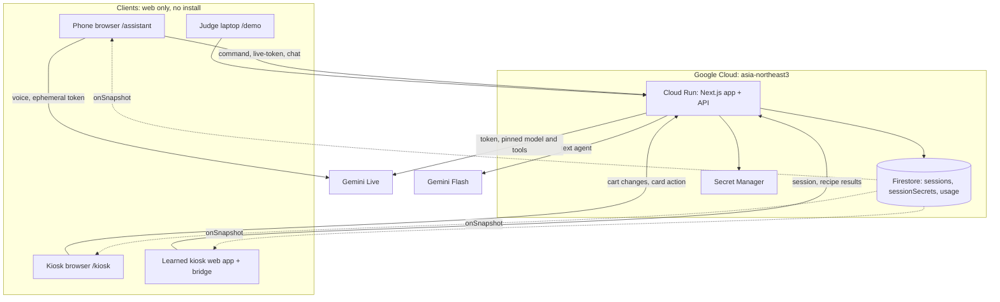
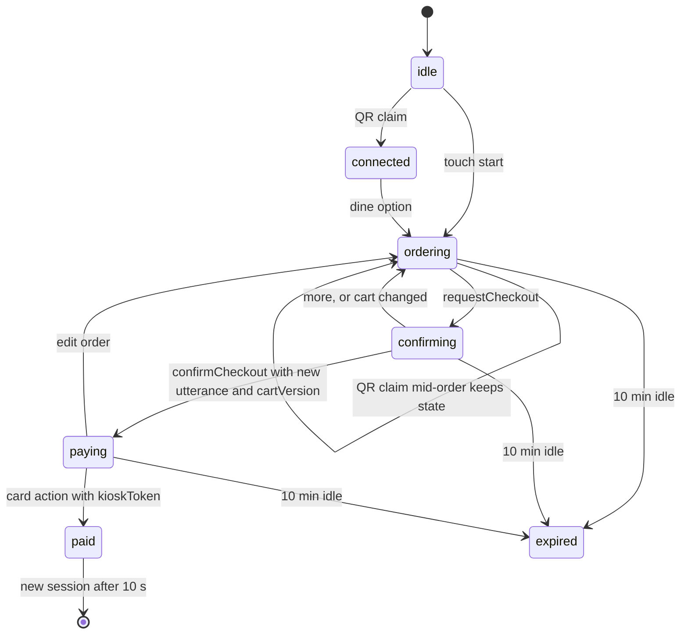

# Architecture

## Directory structure (planned)
```
src/
├── app/
│   ├── kiosk/            # MALO BURGER kiosk simulator (portrait)
│   ├── assistant/        # phone UI opened from the QR
│   ├── demo/             # judge mode: kiosk + assistant side by side
│   ├── learned/          # static learned kiosks (doughhouse, gureum) + bridge script
│   └── api/
│       ├── session/      # create session, claim QR token
│       ├── command/      # every state change (AI tools, phone buttons, kiosk touch)
│       ├── live-token/   # ephemeral token for Gemini Live
│       ├── chat/         # text agent (fallback and /demo text input)
│       └── ping/, health/
├── components/           # CartCard, ConfirmCard, ChoiceButtons, StaffButton, UndoButton, kiosk screens
├── hooks/                # useSession (onSnapshot), useLiveVoice (Live, half-duplex, reconnect)
├── lib/
│   ├── agent/            # instructions + 9 tool declarations, shared by voice and text
│   ├── commands/         # actor table, zod validation, state machine, idempotency
│   ├── adapters/         # KioskAdapter: DirectAdapter (MALO), LearnedAdapter (skill + bridge)
│   └── limits/           # per-session, per-day and per-IP limits
└── types/
data/kiosks/malo.json     # direct-adapter menu with option groups and upsell rules
skills/*.json             # learned kiosk skills (committed after human review)
learner/                  # KIBO Learn (offline, Playwright)
```

## Deployment


## Patterns
- Server Components by default; Client Components only for interactive screens and Firestore subscriptions.
- All writes through `POST /api/command` with `commandId`, actor token and zod-validated arguments; Firestore transaction; `recentCommandIds` (last 30) for idempotency.
- Clients never write Firestore directly. Rules: `sessions` allow `get` only; everything else denied.
- Agent definitions live once in `lib/agent` and are used by both the Live session (pinned via the token) and `/api/chat`.

## Data flow (voice order)
```
User speaks → Gemini Live (phone) → function call → POST /api/command
→ validate (actor, schema, catalog, state) → Firestore transaction (cart, lastChange, screen)
→ onSnapshot → kiosk moves to the category and highlights the line for 2 s; phone updates the cart card
```

## Session state machine


## State management
- Shared order state: Firestore session document (server-written).
- Local UI state: kiosk navigation, open sheets, mic state (React state).
- Conversation history: phone memory only, never stored on the server.

## KIBO Learn
```
learn (offline): kiosk URL → explore (accessibility tree + tappable labels) → record findings
→ write skill (catalog + recipes) → self-test with the AI-free runner (≥3 orders) → audit → human review → commit
run (per order): tool call → validate against skill catalog → bridge replays recipe in page
→ verify kiosk total and cart lines → write session; on mismatch stop, re-read cart, offer staff/touch
```
Prototype and results: `spikes/kibo-learn/`, `spikes/blind-kiosk/`.
