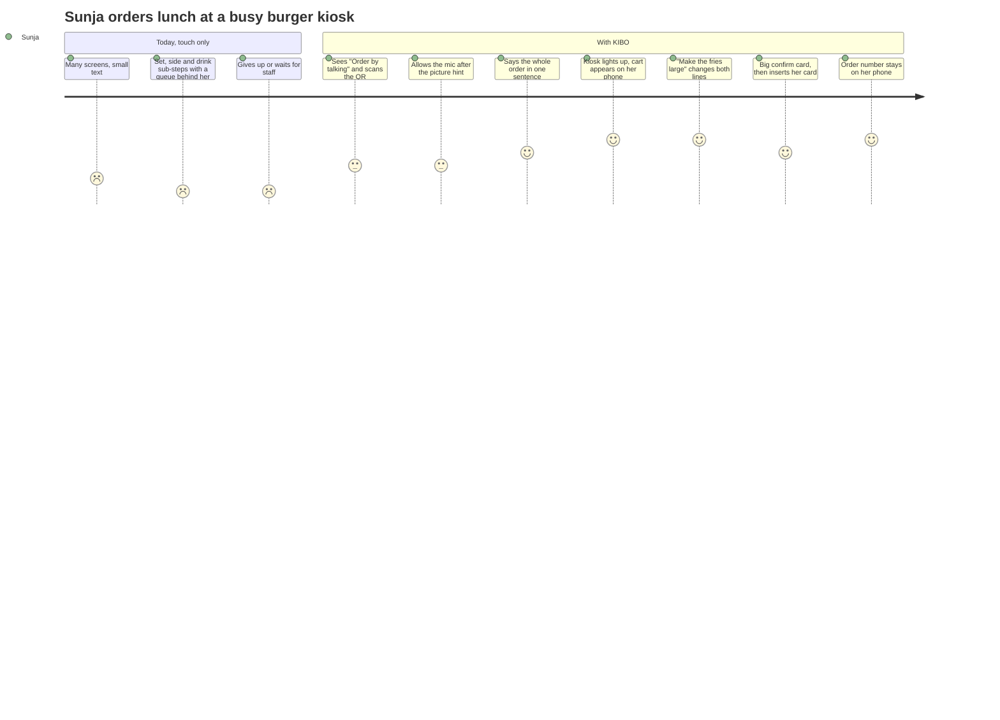
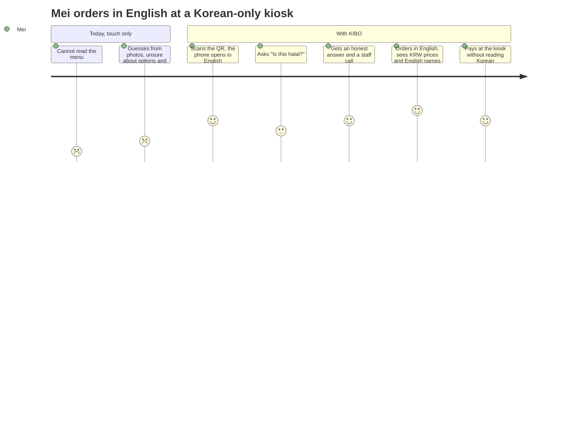
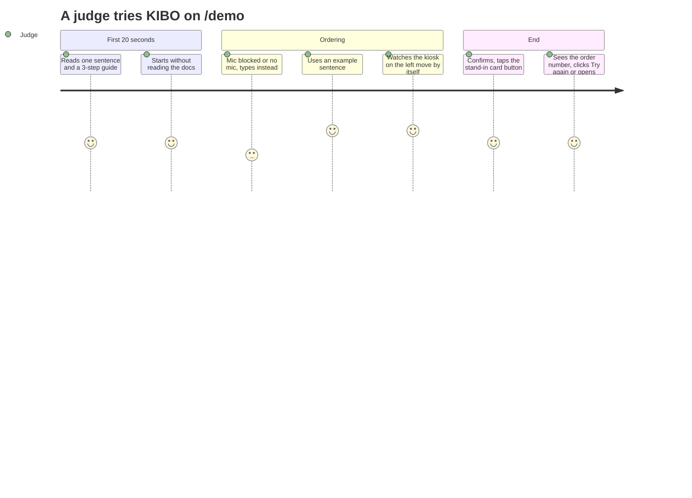

# User journeys
The flows in `docs/UX.md` say what the screens do; journeys say what the person goes through, where they could give up, and which moment must work. Scores are **target feelings** (1 bad – 5 good) for design and QA, not measurements. Personas are in `docs/PRD.md`.

## J1. Sunja (72), lunch rush, first time with KIBO

| Stage | Doing | Thinking | Drop-off risk | What must work (flow, screen) |
|---|---|---|---|---|
| Arrive | Looks at the attract screen | "Can I do this before people get annoyed?" | Does not notice the talk option | Two equal, large choices; "talk (QR)" readable from 1 m (A1) |
| Connect | Scans the QR, opens the link | "Do I need to install something?" | Camera link not tapped; mic prompt denied | No install; picture hint before the browser prompt; deny → text and buttons (A2, A3) |
| Order | Speaks one long sentence | "Did it understand me?" | Silence or a wrong item with no feedback | "Listening…", transcript shown, kiosk highlight within 3 s, cart card with photos (A5, A6) |
| Fix | Changes the fries, says no to dessert | "Will it mess up what I already have?" | Duplicate lines, upsell loop | `updateCart` edits lines; upsell once per order; [Undo] visible (A7) |
| Pay | Reads the confirm card, inserts the card | "Am I paying the right amount?" | Total hidden or tiny; AI pays by itself | Total ≥ 32px; only her "yes" or tap moves to payment; arrow to the kiosk (A8, A9) |
| After | Waits for her number | "What number was it?" | Number lost when the kiosk resets | Large number kept on the phone (A10, A11) |

## J2. Mei (34), tourist, Korean-only kiosk

| Stage | Thinking | Drop-off risk | What must work |
|---|---|---|---|
| Connect | "Is this in my language?" | Phone shows Korean | Phone UI and voice follow the browser language |
| Ask | "Can I trust what it says about food?" | AI guesses about halal or allergens | Answers only from menu data; otherwise calls staff (exception "Not in kiosk data") |
| Ticket (airport rail) | "Two tickets to Seoul Station, please." | The machine sells only its own places; a quiet swap to City Center, or a staff call at once, leaves her unsure or waiting | The AI says plainly what this machine sells (names, minutes, prices from the data), shows those tickets as buttons and [Call staff] last; it never picks one for her (exception "Place the machine does not sell", 15-judge-fixes:1) |
| Order | "Which drink did I get?" | Names only in Korean | `name.en` on the phone; the kiosk starts in Korean (it has an English button on K1, but Mei never needs it) and the 2 s highlight shows where |
| Pay | "Where do I put the card?" | Kiosk payment text is Korean | Phone says "Insert your card into the kiosk" with an arrow (A9) |

## J3. Judge on `/demo`, laptop, about 3 minutes

| Stage | Thinking | Drop-off risk | What must work |
|---|---|---|---|
| Land | "What am I looking at?" | Wall of text, nothing to click | One sentence, 3 steps, three place cards that say who each serves, one [Start] (Flow C1) |
| Try | "Does the AI really drive the kiosk?" | Mic denied, Live down, quota hit | Text input comes forward automatically; clear "try again in a moment" on 429 (Flow C3) |
| Judge | "Is this safe and real?" | AI seems to pay by itself; fake screens | Confirm card visible; kiosk highlight is the proof; no mock video inside the app |
| Leave | "Can I see more?" | Dead end | [Try again] and a link to two-device mode (Flow C5) |

## Using the journeys
- Each "What must work" cell is a QA check: walk it on the real screens during the QA pass in `docs/UI_QA.md`.
- A journey stage that fails goes into `docs/ISSUE.md` with the journey and stage (for example "J1 Pay").
- Screens are named by the ids in the screen map in `docs/UX.md` (K1–K8, KX, P1–P7, PX, D1–D3).
