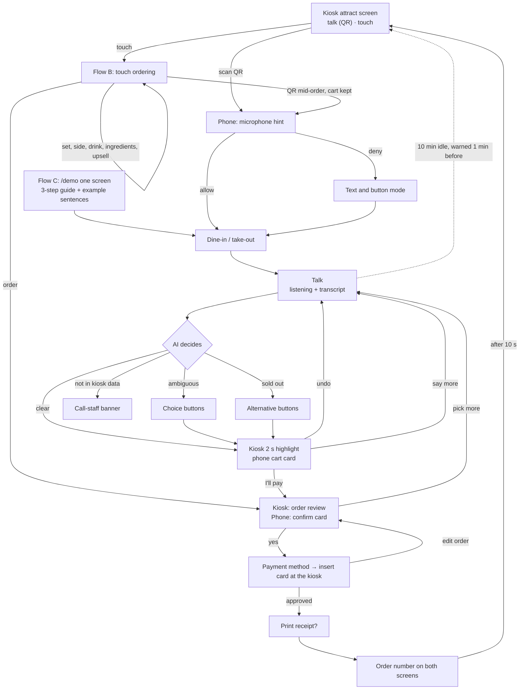
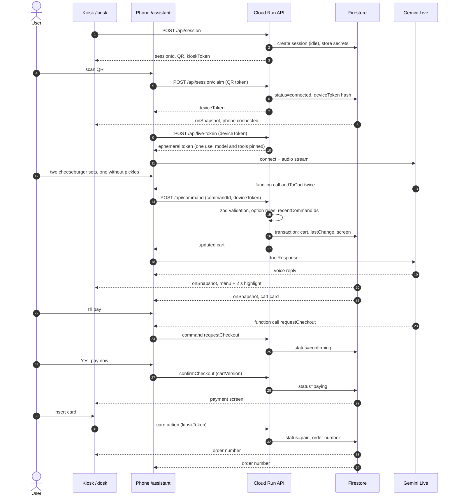

# UX: user flows and Nielsen's 10 heuristics

Principle: **the user only looks at and talks to the phone; the kiosk is a mirror that confirms what changed, and the place to pay.** Designing for an older first-time user makes it easier for tourists and people with disabilities too. Personas are in `docs/PRD.md`.

## Screen roles
| Screen | Role | What the user does |
|---|---|---|
| Phone `/assistant` | **Primary.** Conversation, cart, confirmation | Talk or tap |
| Kiosk `/kiosk` | **Mirror.** Highlights what the AI changed; payment happens here | Glance to confirm; insert the card at the end; may also touch |

The user never has to switch between screens to understand the order: **the phone alone shows every line and the total.**

## Overall flow

## User journeys
What each persona goes through, where they could give up, and which moment must work: `docs/USER_JOURNEY.md`.

## Flow A: Sunja orders with her phone (core)
| # | Kiosk | Phone | Heuristics |
|---|---|---|---|
| A1 | Attract screen with two large choices: "Order by talking (QR)" and "Order by touch" | — | 2, 6 |
| A2 | "Connecting…" next to the QR; under it "Or open **<host>/app** and enter **123 456**" (the 6-digit pairing code; with `SHORT_APP_URL` set, the short host such as **kibo-2026.web.app**, which redirects to `/app`) | Camera shows a link; tapping opens `/assistant`. No install. Or, without a camera app: open `<host>/app`, type the 6 digits, [Connect]; or [Scan a kiosk] on `/app` scans the QR inside the web app (`/app/scan`). All three end in `/assistant` | 1, 7 |
| A3 | "Phone connected"; moves to dine option | **Mic hint screen:** "Tap **Allow** on the next screen" with a picture, then the browser prompt | 1, 10 |
| A4 | Unchanged | "Eat here or take out?" with two large photo buttons; speaking works too | 6 |
| A5 | — | **One large mic button.** "Listening…" with a waveform; stops automatically; shows what it heard | 1, 3 |
| A6 | Moves to the menu; two cheeseburger-set lines are **highlighted** and added. "Added by AI" status | Voice: "Added two cheeseburger sets. One without pickles with zero cola, one with cider." Cart card with photos + **[Undo]** | 1, 2, 3 |
| A7 | Both fries change to L with highlight | "Both fries are now large. +1,000 won" → "Would you like dessert too?" [No thanks] [Show me] (once per order) | 1, 6 |
| A8 | **Order review** screen (same content) | **Confirm card:** items and total in large type. **[Yes, pay now]** **[Pick more]**. Saying "yes" also works after the card appears | 5 |
| A9 | Payment: "Insert or tap your card" animation | "**Insert your card into the kiosk**" with an arrow to the kiosk | 2, 1 |
| A10 | Approving → approved → receipt? → **large order number** | **Large order number** + "We'll call your number at the counter." Stays on the phone | 1, 6 |
| A11 | Back to the attract screen after a visible 10 s countdown | Keeps the order number until the user closes it, then clears conversation and cart | 1 |

## Flow B: touch ordering
Pressing "Order by touch" runs the familiar kiosk flow (dine option → category → item → set → side → drink → ingredients → review → payment). **The user can switch to voice at any time by scanning the small QR on every screen; the cart is kept.**

## Flow C: judges on `/demo`
- **C1** One-sentence intro and a **3-step guide**: ① talk or type on the right ② watch the kiosk on the left move ③ confirm to pay. Three equal **place cards**, each with a capture of its kiosk, a title, one line and the persona it serves: Burger shop (MALO BURGER, connected directly, default), Airport rail (SKYLINE AIRPORT RAIL ticket machine) and Pizza shop, no integration (Doughhouse, learned by KIBO Learn). **[Start]** opens the selected card; the choice is in the URL (`/demo?k=malo|airport_rail|doughhouse`). The kiosk half's caption names the place.
- **C2** The assistant on the right is **the same component** as `/assistant`, in English, with the place's example sentences (`examplesFor(kioskId, "en")`; MALO: "One cheeseburger set with zero cola", "Make the fries large", "Is this halal?"). On the ticket machine the phone skips the dine question and goes straight to talking.
- **C2a** An optional **[Scenarios]** column, open by default from 1440px wide (closed below), lists what to try on this kiosk (`scenariosFor(kioskId)` in `src/lib/demo/scenarios.ts`): title, persona, goal and tags as text labels. Choosing one starts a fresh order (like [Try again]) and shows its steps: each sentence is a chip that sends it as the user's message, with a "watch" hint and a check mark that ticks from the live session. **[Play it for me]** sends the same sentences through the same path (real `/api/chat`), one per step, waits up to 20 s for the step's check, pauses 1.5 s, and stops at the confirm card: "Your turn: tap **Yes, pay now** on the phone, then the card on the kiosk." It needs the dine option first, never sends from `confirming` on, never retries, and on a failed step says "This step didn't go as expected. You can type it yourself or try again."
- **C2b** **What the AI did** (from 1440px wide at the bottom of the scenario column, open; below that under the phone, collapsed with a count) lists each tool call Gemini made and what the KIBO server answered, newest first: plain words from menu data ("Added 1 × Cheeseburger set (Zero cola · No pickles)", "Tried to pay → the confirm card is required") and the tool name with its result in a second line (`addToCart ✓ 180 ms`, `confirmCheckout refused (CONFLICT)`), under the legend "Gemini decides; the KIBO server checks every action against the kiosk's data and rules before the kiosk moves." Beside the phone it stays through the review; under the phone it steps aside while the confirm card is open, so the total and [Yes, pay now] stay on screen, and comes back with its rows after [Pick more] (I-129, I-084). Below 900px wide `/demo` says "Open this on a laptop" and links to the kiosk's two-device mode (I-074). Typed and spoken turns both report. Not a live region (the cart announcements are). The phone `/assistant` never shows it (heuristic 8).
- **C3** If there is no mic or it is denied, or the Live connection fails, text input comes forward automatically. On `/demo` the phone's text field is open from the start; on `/assistant` it sits behind [Type] in the bottom dock and, once opened, stays open for the order (`docs/UI_GUIDE.md` "Phone design").
- **C1a** Next to [Start], **[Use my phone instead]** runs the same place with a real phone: the kiosk on the left, and in place of the simulated phone KIBO's pairing panel (as on a landscape `/kiosk`): a large QR, "scan with your phone camera, or open **<host>/app** and enter the code", the 6-digit code, three steps, then "Phone connected at <time>" and a read-only status line (step, item count, total, who made the last change). The judge orders by voice on their own phone; the session keeps the demo limits. The scenario guide stays, its sentences as text to say on the phone (no chips, no [Play it for me]); choosing a scenario keeps the current order, so the phone needs no new scan. The kiosk half offers [Connect another phone], and the panel follows the new QR at once. Payment is on the kiosk half. At the end the panel shows **[Try again]** (a fresh pairable order, so the phone scans again) and **Try another place**; there is no Touch vs talk card, because the messages and taps happened on the other phone. [Back to the start] returns to D1.
- **C4** At payment, an "Insert the card at the kiosk" button stands in for the card action. P5 names the kiosk's own button ("On the kiosk, tap 카드 (Card), then insert your card."), and its picture points left, toward the kiosk half.
- **C5** On MALO BURGER, a **Touch vs talk** card comes first: "This order with KIBO" (messages to the AI, taps on the phone, taps on the kiosk and seconds from [Start] to the order number, counted in this browser for this order) beside the hero order by touch (the medians of `evidence/human-runs.json` when it exists, else the automated efficient run's taps, with "Not shown: an automated run taps at machine speed." for its time). The touch side is titled "The same order by touch" only when this cart is the hero cart, else "The reference order by touch" with the reference order spelled out from menu data. No ratios. Then: **[Try again]**, **Try another place** with the two other places, and a link to the real two-device mode of the same kiosk (`/kiosk?k=<kioskId>`). The ticket machine ends with a reference number ("Please take your tickets from the machine."). With the learned pizza kiosk the order ends at the review (the user would pay on the kiosk itself): **[Try again]** and **Try another place**.

## Exception flows
| Situation | Phone | Kiosk | Heuristics |
|---|---|---|---|
| **Misheard** | Shows what it heard. **[Undo]** once or "No, cancel that" reverts the last change | Last change reverted | 3, 9 |
| **Ambiguous** ("one burger") | Asks with **choice buttons** (photos): cheeseburger / bulgogi / double… then "Make it a set?" No need to remember options | Shows the category | 6, 5 |
| **Sold out** | "The shrimp burger is sold out." + two similar items as buttons | Sold-out mark | 9 |
| **Not in kiosk data** (halal etc.) | Does not guess: "This kiosk doesn't have that information. **I've called staff.**" | Staff banner | 9, 10 |
| **User is stuck** | **[Call staff]** always visible at the top | Staff banner | 3, 10 |
| **Phone screen off / disconnected** | Reopening on the same phone **continues** (token stored on the phone); cart kept | "Connection paused" after 60 s without ping; touch still works | 3, 9 |
| **Idle** | One minute before expiry: "Still ordering?" **[Continue]** | Same warning | 5 |
| **Someone else scans the same QR** | "Someone else is using this kiosk" | Unchanged | 5 |
| **Noise** | After two failures: "Try typing or choosing a button" | — | 9, 7 |
| **Learned kiosk replay fails** | "Please check the kiosk screen" + [Call staff] | Shows its own real cart; the session keeps its last verified cart and calls staff | 9 |
| **Change of mind at payment** | — | **[Edit order]** returns to review | 3 |

## Screen map
Every screen and state that a QA pass must look at (`docs/UI_QA.md`). Ids are used in QA findings.

| Id | Screen | Session status | Next |
|---|---|---|---|
| K1 | Kiosk attract (talk QR, touch, large text). On a landscape screen KIBO's pairing panel sits beside every kiosk screen (QR, code, phone status; see Flow C1a) | `idle` | K2 or phone P1 |
| K2 | Kiosk dine-in / take-out, small QR in the toolbar row; [처음으로] bottom left (standalone `/kiosk` only) | `connected` / `ordering` | K3, or K1 by [처음으로] |
| K3 | Kiosk menu: category rail, photo grid, cart bar ([처음으로] first in its button row on the standalone `/kiosk`; with items it asks "주문을 취소하고 처음으로 갈까요?" first), small QR | `ordering` | K4, K5, K6, or K1 by [처음으로] |
| K4 | Kiosk product sheet: set → side → drink → ingredients | `ordering` | K3 |
| K5 | Kiosk upsell pop-up (once per order) | `ordering` | K3 |
| K6 | Kiosk order review | `confirming` | K7 or K3 |
| K7 | Kiosk payment method → card insert → approving | `paying` | K8 or K6 (edit) |
| K8 | Kiosk receipt? → order number | `paid` | K1 after 10 s |
| KX | Kiosk banners: staff called and connection paused (a strip at the top that pushes the screen down), AI highlight + status line (in the toolbar row for 2 s), idle warning; "일시정지됨 · 화면을 누르면 계속합니다" with "Paused · Tap to continue" below, over the whole screen after 20 min with no change and no touch (the kiosk stops reading the order until tapped; the tap only resumes, it presses nothing under it, and the kiosk comes back on the same screen with the current cart) | any | — |
| P0 | Phone app home `/app` (the installed app's start page; optional, a QR link never needs it): [Continue my order] while this phone holds an open order, the 6-digit code field with [Connect] (wrong code: "That code doesn't match a kiosk. Check the number on the kiosk screen."), [Scan a kiosk], how it works, settings (language, AI voice, larger text) that `/assistant` reads; in an in-app browser a note to open Safari or Chrome | — | P1 by [Connect], the scanner, or P2–P5 by [Continue my order] |
| P0-scan | Phone QR scanner `/app/scan`: camera hint with [Turn on the camera] (nothing starts before the tap), scanning (camera with a framing square, "Point at the QR on the kiosk", light toggle when the camera has one), "This QR is not a KIBO kiosk." for any other code, and without a camera "Open your camera app and scan the QR there, or paste the link below" with a link field | — | P1 (`/assistant`, the claim runs there), or `/app` by [Back] |
| P1 | Phone mic hint (or in-app browser warning) | `connected`, or `ordering` when scanned mid-order | P2, or P3 when the dine option is already set; text mode if denied |
| P2 | Phone dine option (not on a kiosk without dine options, such as the ticket machine: P3 directly) | `connected` | P3 |
| P3 | Phone talk: mic, transcript, last two messages, cart card, choices, [Undo] | `ordering` | P4 |
| P4 | Phone confirm card: the lines and [Pick more] scroll; the total, [Yes, pay now] and a compact mic ("You can also say yes.") with [Type] stay at the bottom. On a learned kiosk: no [Yes, pay now]; "Tap 주문하기 (Order) on the kiosk and pay there." (label from the skill) and [Pick more] | `confirming` | P5 or P3 (learned: ends here) |
| P5 | Phone "insert your card into the kiosk" | `paying` | P6 |
| P6 | Phone order number, kept until the user closes it | `paid` | P7 |
| P7 | Phone session ended / someone else is using this kiosk | `expired` / other | — |
| PX | Phone overlays: idle warning, staff called, reconnecting, "Please check the kiosk screen" (learned kiosk), "Paused · Tap to continue" after 20 min with no change and no input (not after payment, so the order number stays in view; also on `/demo` D2) | any | — |
| D1 | `/demo` intro with 3-step guide and three place cards (burger shop, airport rail, pizza shop); [Start] and [Use my phone instead] | — | D2 |
| D2 | `/demo` split: kiosk left, assistant right, example sentences, card stand-in, optional scenario guide on the right (open from 1440px wide) with "What the AI did" at its bottom (under the phone below 1440px). Own-phone state ([Use my phone instead]): the pairing panel instead of the assistant, waiting (QR, code, steps) then connected (phone status, read-only order line); guide sentences as text; no "What the AI did" | all (own phone: `idle` until claimed) | D3 |
| D3 | `/demo` end: Touch vs talk card (MALO only), [Try again], Try another place (the two other places), link to `/kiosk?k=<kioskId>`; learned kiosk: at the review, [Try again], Try another place | `paid` (learned: `confirming`) | D1 |

## Nielsen's 10 heuristics, as KIBO rules
| # | Heuristic | KIBO rule |
|---|---|---|
| 1 | Visibility of system status | Always show connection, "listening", "working", "AI is helping". AI changes get a **2 s highlight** on the kiosk. Spoken replies are also shown as text |
| 2 | Match with the real world | Use counter-staff words ("Added", "Eat here?"). Never show technical terms (session, token, agent) |
| 3 | User control and freedom | **[Undo]** after every change. Switch between touch and voice any time. Cancel anything before payment. **The AI cannot reach payment without the user** |
| 4 | Consistency and standards | Phone and kiosk use the same item names, price format and order. Fixed button positions (primary bottom right, staff at top). `/demo` and `/assistant` share components. All kiosks share one flow |
| 5 | Error prevention | Confirm card, ask when ambiguous, server-side option and price validation, expiry warning, duplicate-command blocking |
| 6 | Recognition rather than recall | Choices shown as **buttons with photos**; example sentences; the cart is always visible on the phone; the order number stays |
| 7 | Flexibility and efficiency | Experts say it in one sentence; first-timers go step by step with questions and buttons; touch, voice and text all work |
| 8 | Minimalist design | **One task per screen** on the phone. Only the last two messages are large. Demo counters appear **only in demo mode** |
| 9 | Recognize, diagnose, recover | Errors say what failed and what to do next in plain words ("The shrimp burger is sold out. How about this?"). No red alerts or error codes |
| 10 | Help and documentation | "Try saying…" examples at the start and when stuck; the staff button is always there; mic permission hint on first use |

## Accessibility (set for older users)
- **Text:** phone body ≥ 20px; totals and order numbers ≥ 32px; all kiosk text ≥ 40px on the 1080×1920 canvas (`docs/UI_GUIDE.md`). Respect the system font size.
- **Touch targets:** ≥ 56×56px; primary buttons full width on the phone.
- **Contrast:** body ≥ 4.5:1 (WCAG AA). Never rely on color alone.
- **Screen readers:** every control labelled; cart changes announced with `aria-live` when AI voice is off (suppressed while the AI speaks, to avoid overlap).
- **Voice replies:** short, one thing at a time, slightly slow; can be turned off. Half-duplex (mic paused while the AI speaks) to avoid self-interruption.
- **Language:** phone UI and AI voice support Korean and English, follow the browser language (anything else falls back to English) and can be changed; the kiosk starts in its default language (Korean) and its K1 language row switches the kiosk to English for one order.
- **In-app browsers** (KakaoTalk, Naver, Instagram, Facebook, LINE) have unreliable microphones: detect and suggest opening in Safari/Chrome. P1 shows [Copy link] before the phone claims the QR, so the copied link still connects in the other browser; [Order here by typing] claims in the app and a banner stays. `/app` and `/app/scan` show the same advice (cameras often fail there too).

## Copy
- Polite, short sentences, one piece of information per sentence.
- Action buttons are verbs: [Yes, pay now], [Undo], [Call staff].
- Kiosk copy follows real kiosk wording: "Make it a set?", "Insert your card below", "Print a receipt?".

## System sequence (Flow A)

## Prototype
`design/prototype/Main.dc.html` (Claude Design) implements Flow A, Flow B and the main exceptions with generated menu photos. Its state logic is checked by `design/prototype/e2e_check.py` (42 checks).
